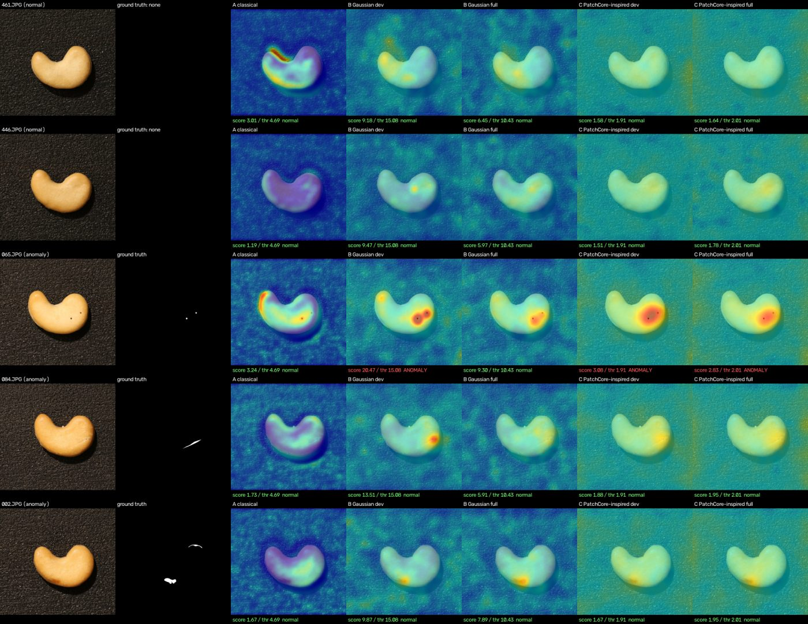
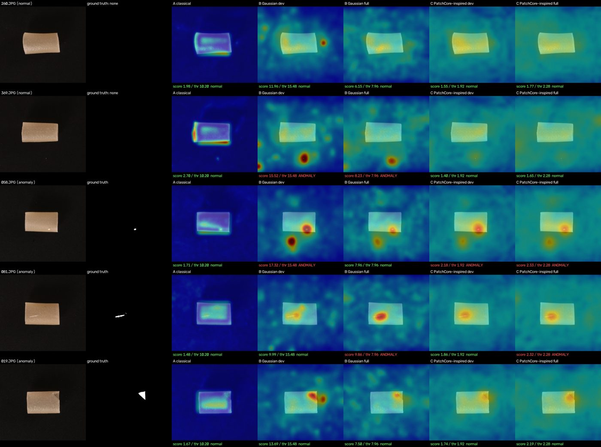

# InspectAI — Industrial Visual Anomaly Detection

InspectAI finds defective products in photographs, shows where the defect is, and reports how far an image is from normal. It learns **only from normal images** of each product and is evaluated on the VisA benchmark (Amazon, ECCV 2022). Three methods are implemented and compared on identical splits: a classical OpenCV baseline, a Gaussian feature model on frozen pretrained CNN features (PaDiM-inspired), and a PatchCore-inspired nearest-neighbor model. Everything runs on an ordinary Windows CPU, and a Streamlit app serves the saved models. The full specification is in [SPEC.md](SPEC.md).

**Status: all milestones (0-7) are done; read [Limitations](#limitations) before relying on any result.** The project is a research and educational prototype, not a certified quality-control system. A dataset-free hosted bundle (Model C as the primary model) is prepared and verified locally but has not been deployed or tested on a host, and the app's on-screen layout was not visually verified in a browser.

## Key features

- **Dataset tooling:** a split-file parser and validator for all 12 VisA objects, safe image and mask loading, and reproducible `fit` / `calibration_normal` / `test` splits with no test-set leakage.
- **Three models, one harness:** classical baseline, Gaussian (Mahalanobis) model, and a PatchCore-inspired model with a memory-bank limit, a time limit, and a recorded `max_fit_images` cap.
- **Honest evaluation:** image AUROC and AP with bootstrap confidence intervals and sample counts, pixel metrics, per-category thresholds chosen without test data, paired AUROC differences, and a comparison tool that refuses to compare runs that were not evaluated identically.
- **Checked artifacts:** fitted models are saved as safetensors with checksums, shapes, and a stored split and threshold; they are never pickled and are verified on every load.
- **Streamlit app:** upload or pick an image, see the decision, the score next to its threshold and the normal-score range, the heatmap and overlay, and an evaluation dashboard that validates its data before showing it.
- **Reproducible and tested:** fixed seeds, bit-for-bit reproducible fits, a synthetic end-to-end demo that needs no dataset or weights, and an automated test suite.

## Architecture

```text
 VisA images + masks + split file (outside the repository)
          |
          v
 data/        parse and validate -> fit | calibration_normal | test  (seeded, disjoint, split.json)
          |
          v
 preprocessing/   resize (letterbox or stretch) -> ImageNet normalization
          |
          +--> models/classical   (Model A)  per-pixel mean / std z-score
          |
          +--> models/features    frozen ResNet-18 / Wide ResNet-50-2, layer2 + layer3
                   |
                   +--> models/gaussian   (Model B)  per-position Gaussian, Mahalanobis distance
                   +--> models/patchcore  (Model C)  coreset memory bank, nearest-neighbor distance
          |
          v   anomaly map (input size) + image score (max of the map)
 evaluation/  thresholds from calibration_normal -> score test -> metrics -> predictions.csv, summary.json
          |                                  |
          |                                  v
          |                       artifacts/   manifest + tensors + split + config (checked on load)
          v
 evaluation/comparison  verify + compare -> comparison.json / .csv / .md, figures
          |
          v
 inference/ + ui/   load artifacts -> inspect an image -> Streamlit pages (Home, Inspect, Dashboard, About)
```

How each part works is explained in [docs/architecture.md](docs/architecture.md).

## Technologies

Python 3.12 · PyTorch 2.14 (CPU) and torchvision 0.29 (ImageNet-1k ResNet-18 and Wide ResNet-50-2 weights) · NumPy · OpenCV (headless) · Pillow · scikit-learn (metrics only) · safetensors · PyYAML · psutil · Streamlit 1.66 · pytest · Ruff. The exact versions are pinned in `requirements-lock.txt`. No GPU, paid service, or network call is needed at run time; the only downloads are the explicit weight fetch and the dataset you choose to download.

## Hardware and runtime

| Item | Value |
|---|---|
| Machine used for every measurement | AMD Ryzen 5 5500U (6 cores / 12 threads), 16 GB RAM, no GPU, Windows 11, plugged in, **Balanced** power plan |
| Python / PyTorch | 3.12.2 / 2.14.1+cpu |
| Fit time (400-408 images) | classical about 8 s · Model B 15-66 s · Model C about 10-12 minutes |
| Prediction latency per image | classical about 14 ms · Model B 34-130 ms · Model C 0.2-0.65 s |
| Peak memory while fitting | 0.4 GB (classical) · 0.74-1.04 GB (Model B) · 1.2 GB (Model C `dev`) · 2.9 GB (Model C `full`) |
| Synthetic end-to-end demo | about 13 s |
| Default test suite | about 2 minutes |

The measurements are detailed in the model sections below and in [docs/environment.md](docs/environment.md).

## Documentation

- [docs/architecture.md](docs/architecture.md): data flow, feature extraction, splits and thresholds, how each model scores, persistence, and the UI integration.
- [docs/evaluation.md](docs/evaluation.md): metrics, threshold selection, comparison method, deviations from the published algorithms, and how to reproduce every number.
- [docs/limitations.md](docs/limitations.md): what the results do not show, what is unfinished, and future work.
- [docs/final_report.md](docs/final_report.md): the final project report with the Definition-of-Done check.
- [docs/environment.md](docs/environment.md): hardware, versions, and locations.

## Installation (Windows PowerShell)

Keep the repository, virtual environment, dataset, and artifacts **outside OneDrive** (SPEC.md Section 9.2); a OneDrive-synced folder can lock or re-upload large files. If you must use a synced folder, pause syncing for these directories.

```powershell
# 1. Virtual environment (outside OneDrive)
New-Item -ItemType Directory -Force C:\dev\venvs | Out-Null
py -3.12 -m venv C:\dev\venvs\inspectai
C:\dev\venvs\inspectai\Scripts\Activate.ps1
python -m pip install --upgrade pip

# 2. CPU-only PyTorch first, then the project
pip install torch torchvision --index-url https://download.pytorch.org/whl/cpu
cd C:\dev\inspectai
pip install -e ".[dev]"
```

`requirements-lock.txt` lists the exact package versions the project was last verified with.

### Environment variables

Machine-specific locations come from environment variables and are never committed (`configs/default.yaml` refers to them as `${INSPECTAI_DATA_ROOT}` and so on). Set them once for your user account, then open a new terminal:

```powershell
[Environment]::SetEnvironmentVariable('INSPECTAI_DATA_ROOT',    'C:\dev\inspectai-data',           'User')
[Environment]::SetEnvironmentVariable('INSPECTAI_ARTIFACT_DIR', 'C:\dev\inspectai-data\artifacts', 'User')
[Environment]::SetEnvironmentVariable('INSPECTAI_REPORT_DIR',   'C:\dev\inspectai-data\reports',   'User')
[Environment]::SetEnvironmentVariable('TORCH_HOME',             'C:\dev\inspectai-data\torch_cache', 'User')
```

### Configuration

`configs/default.yaml` is the readable reference of every default (splits, thresholds, evaluation, model settings, limits, upload rules). `inspectai.settings.load_default_config` validates it by building the real settings objects (an invalid value raises a clear `ConfigError`), and a test fails if any value in the file differs from the default in the code. Command-line flags override the defaults. Only CPU execution is supported: `device: cpu` is the only accepted value, and nothing is ever moved to a GPU.

## Dataset download and setup

The VisA dataset is **not** part of this repository and no script downloads it; downloading is something you do yourself, from the official links only. It is released under CC BY 4.0 (see [attribution](#dataset-attribution-and-licensing)). The official source is <https://github.com/amazon-science/spot-diff>.

1. **Disk space.** You need the archive size plus a margin (about 1.93 GB + 1 GB) and about 1.92 GB for the extracted images.
2. **Download the archive** from the link in the official README (do not use mirrors) into a staging folder outside the repository and OneDrive:

   ```powershell
   New-Item -ItemType Directory -Force C:\dev\inspectai-data\downloads | Out-Null
   curl.exe -L -o C:\dev\inspectai-data\downloads\VisA_20220922.tar https://amazon-visual-anomaly.s3.us-west-2.amazonaws.com/VisA_20220922.tar
   ```

3. **Verify it.** The archive was 1,929,840,640 bytes with SHA-256 `2EB8690C803AB37DE0324772964100169EC8BA1FA3F7E94291C9CA673F40F362` when this project was built (the official README documents no checksum):

   ```powershell
   (Get-Item C:\dev\inspectai-data\downloads\VisA_20220922.tar).Length
   Get-FileHash -Algorithm SHA256 C:\dev\inspectai-data\downloads\VisA_20220922.tar
   tar -tf C:\dev\inspectai-data\downloads\VisA_20220922.tar | Select-String -Pattern '^/|\.\.' | Select-Object -First 3   # must print nothing
   ```

4. **Extract** so that the object folders end up under `visa\VisA\` (the archive has no top-level `VisA` folder; it also contains `split_csv\` and `LICENSE-DATASET`):

   ```powershell
   New-Item -ItemType Directory -Force C:\dev\inspectai-data\visa\VisA | Out-Null
   tar -xf C:\dev\inspectai-data\downloads\VisA_20220922.tar -C C:\dev\inspectai-data\visa\VisA
   ```

5. **Place the split file** where the loader expects it. The archive's own copy is identical to the official one (SHA-256 `A48557E6033318CB90556F706196BC9D247A776A23EA51AECEE5A80DD0332995`, repository commit `2a692ab575001cbde74d402d897a7286086c6199`):

   ```powershell
   New-Item -ItemType Directory -Force C:\dev\inspectai-data\visa\split_csv | Out-Null
   Copy-Item C:\dev\inspectai-data\visa\VisA\split_csv\1cls.csv C:\dev\inspectai-data\visa\split_csv\1cls.csv
   ```

6. **Validate** (expect 10,821 rows and 0 errors), then delete the archive:

   ```powershell
   python scripts/validate_dataset.py
   Remove-Item C:\dev\inspectai-data\downloads\VisA_20220922.tar
   ```

The loader reads `1cls.csv` directly and never copies images, so the official `prepare_data.py` is not needed. The resulting layout is:

```text
C:\dev\inspectai-data\visa\
├── split_csv\1cls.csv
└── VisA\<object>\Data\Images\{Normal,Anomaly}\... and Data\Masks\Anomaly\...
```

### Pretrained weights

The deep models use torchvision's ImageNet weights, which are fetched only on request and cached under `TORCH_HOME`:

```powershell
python scripts/fetch_weights.py --backbone resnet18          # 45 MB, the `dev` profile
python scripts/fetch_weights.py --backbone wide_resnet50_2   # 132 MB, the `full` profile
```

Without cached weights, the scripts and the app stop with an explanation (exit code 4) and never use random weights.

## Verify the setup

```powershell
python -c "import inspectai; print(inspectai.__version__)"
pytest                                    # about 2 minutes; needs neither the dataset nor weights
ruff check . ; ruff format --check .
python scripts/run_demo.py                # about 13 seconds, synthetic data, end to end
pytest -m "needs_dataset or slow"         # optional: uses the real dataset and cached weights
```

`scripts/run_demo.py` generates a small synthetic VisA-style dataset, fits all three models with a deterministic fake backbone, reloads the saved artifacts, predicts every test image the way the app does, checks each score and decision against the saved evaluation report, and writes a comparison report, a visualization, and prediction details. Its metrics come from random synthetic images and mean nothing; it proves that the pipeline works end to end.

## Validate the dataset

Requires the VisA data under `INSPECTAI_DATA_ROOT` (see above). The command checks every row of `1cls.csv`, reports counts and per-object image-size and aspect-ratio statistics (with a recommended resize mode), and writes a JSON report to `INSPECTAI_REPORT_DIR`.

```powershell
python scripts/validate_dataset.py
python scripts/validate_dataset.py --objects cashew pipe_fryum --write-splits
```

`--write-splits` writes `split.json` (fit / calibration_normal / test, seed 42 by default) per object to `<INSPECTAI_ARTIFACT_DIR>\splits\<object>\`, and refuses to overwrite a different existing split. Exit codes: 0 success, 2 configuration or data error, 1 other failure.

## Evaluate the classical baseline (Model A)

```powershell
python scripts/evaluate_model.py --model classical --category cashew
python scripts/evaluate_model.py --model classical --category cashew --threshold-policy labeled_calibration
```

The baseline stores a per-pixel mean and standard deviation of the `fit` images. `evaluate_model.py` fits it inside the command (about 8 s; test images are only scored). `python scripts/fit_model.py --model classical --category cashew` writes it as an artifact (two float32 arrays, no pretrained weights needed), which the app loads; the artifact reproduces the evaluation scores exactly. The default threshold is the 0.99 quantile of scores on `calibration_normal` (SPEC.md Section 3.5); `labeled_calibration` picks max-F1 on half of the test rows and reports on the other half (`test_eval`) only, stratified by label (defect-type stratification from `image_anno.csv` is not implemented). Pixel IoU/Dice are pooled over all test images at 256x256 and use a threshold from `calibration_normal` map values.

Output goes to `<INSPECTAI_REPORT_DIR>\classical\<category>\`: `predictions.csv` (one row per image), `summary.json` (settings, split hashes, thresholds, metrics with sample counts and a 95% bootstrap CI for image AUROC, timings, memory, environment), and `examples\*.png`. Undefined metrics are `null` and listed in `undefined_metrics`.

### Measured results (classical baseline, seed 42, split `test`, 256x256)

These come from the runs above on the reference laptop (plugged in, Windows Balanced power plan; the numbers were reproduced exactly after the Milestone 3 and 4 code changes). They are the classical baseline only; the deep models are measured in the sections below.

| Category | Normal / anomalous | Image AUROC (95% CI) | Image AP | Pixel AUROC | F1 at threshold | Fit time | Predict latency |
|---|---|---|---|---|---|---|---|
| cashew | 50 / 100 | 0.701 (0.603-0.794) | 0.818 | 0.809 | 0.305 (recall 0.18, FPR 0.00) | 7.8 s | 13.5 ms |
| pipe_fryum | 50 / 100 | 0.674 (0.587-0.759) | 0.818 | 0.963 | 0.148 (recall 0.08, FPR 0.00) | 7.2 s | 13.5 ms |

The baseline is weak, as expected: it compares each pixel position with the average of the training images, so it responds to object shifts and shape differences more than to the small defects (see `examples\anomaly_highest_score.png`). With only 45 calibration images, the 0.99 quantile sits near their maximum, so the threshold is conservative (no false positives, but low recall). Pixel AUROC is high partly because most pixels are background that every map ranks low; read it with IoU and Dice in `summary.json`. A random ranking has image AP equal to the anomaly share of the test set (0.667).

## Model B: Gaussian feature model (PaDiM-inspired)

Model B fits a Gaussian (mean and regularized covariance) at every position of the layer2+layer3 feature map of a frozen ImageNet-pretrained ResNet, on a fixed random subset of d = 100 channels. The anomaly score at a position is the Mahalanobis distance. The map is upsampled, smoothed (sigma 4), and mapped back to the original image size; the image score is the maximum of the map. Deviations from the PaDiM paper are listed in the docstring of `src/inspectai/models/gaussian.py`.

Profiles (SPEC.md Section 5.5): `dev` = `resnet18`, `full` = `wide_resnet50_2`, both at 224x224 with layers `layer2` and `layer3`.

```powershell
# 1. Fetch the pretrained weights once (an explicit download; nothing else downloads them)
python scripts/fetch_weights.py --backbone resnet18

# 2. Fit on the fit split, select thresholds on calibration_normal, save the artifact
python scripts/fit_model.py --model gaussian --category cashew --profile dev

# 3. Evaluate the saved artifact on the test split (loads it; never refits)
python scripts/evaluate_model.py --model gaussian --category cashew --profile dev
```

Without cached weights, `fit_model.py` and `evaluate_model.py` stop with `WeightsNotFoundError` (exit code 4) and print the fetch command; they never fall back to random weights. Set `INSPECTAI_ALLOW_WEIGHT_DOWNLOAD=1` only for a hosted deployment that must download at load time.

### Artifacts

`fit_model.py` writes `<INSPECTAI_ARTIFACT_DIR>\gaussian\<category>\` with `manifest.json`, `tensors.safetensors` (means, inverse covariances, channel indices), `split.json`, and `config.snapshot.yaml`. The manifest records the backbone and weights identifier with the weights file SHA-256, layers, image size, d, resize mode, reference aspect ratio, seed, the image and pixel thresholds, the calibration score range, fit time and peak memory, library versions, and the SHA-256 of every data file. Nothing is read with pickle. On load, the schema version, checksums, tensor shapes and dtypes, absence of NaN/Inf, and the split (no overlap between `fit` and `test`) are verified; any problem raises `ArtifactError` (exit code 3). An artifact whose configuration snapshot differs from the requested settings (for example a different `--feature-dim`) is rejected as stale. Artifacts are not committed to Git.

### Measured results (Model B, `dev` profile, seed 42, split `test`, 256x256)

Measured on the reference laptop (Ryzen 5 5500U, 6 threads), plugged in, with the Windows **Balanced** power plan (recorded in each `summary.json` and artifact manifest; SPEC.md Section 5.5 recommends High performance, so these times are probably conservative), after `fetch_weights.py --backbone resnet18`. Same splits and evaluation resolution as the classical baseline above.

| Category | Model | Image AUROC (95% CI) | Image AP | Pixel AUROC | F1 at threshold (recall, FPR) |
|---|---|---|---|---|---|
| cashew | classical | 0.701 (0.603-0.794) | 0.818 | 0.809 | 0.305 (0.18, 0.00) |
| cashew | gaussian | 0.916 (0.871-0.955) | 0.962 | 0.987 | 0.701 (0.54, 0.00) |
| pipe_fryum | classical | 0.674 (0.587-0.759) | 0.818 | 0.963 | 0.148 (0.08, 0.00) |
| pipe_fryum | gaussian | 0.933 (0.885-0.967) | 0.963 | 0.992 | 0.701 (0.55, 0.04) |

Each category has 50 normal and 100 anomalous test images. Model B IoU / Dice at the pixel threshold: cashew 0.19 / 0.32, pipe_fryum 0.20 / 0.34 (pooled over all test images; the threshold comes from `calibration_normal`, so it is conservative).

#### `full` profile (`wide_resnet50_2`, 1536 feature channels, d = 100)

Weights fetched with `fetch_weights.py --backbone wide_resnet50_2` (SHA-256 `95faca4d...`, hash verified). Same splits, seed, thresholds policy, and evaluation resolution; artifacts were written to a separate folder (`--output-dir`) so the `dev` artifacts stay reproducible. Both profiles use the same 405 fit images, 45 calibration images and 150 test images per category.

| Category | Profile | Image AUROC (95% CI) | Image AP | Pixel AUROC | Pixel IoU / Dice | F1 (recall, FPR) |
|---|---|---|---|---|---|---|
| cashew | dev | 0.916 (0.871-0.955) | 0.962 | 0.987 | 0.19 / 0.32 | 0.701 (0.54, 0.00) |
| cashew | full | 0.876 (0.818-0.928) | 0.937 | 0.990 | 0.26 / 0.41 | 0.246 (0.14, 0.00) |
| pipe_fryum | dev | 0.933 (0.885-0.967) | 0.963 | 0.992 | 0.20 / 0.34 | 0.701 (0.55, 0.04) |
| pipe_fryum | full | 0.932 (0.882-0.973) | 0.960 | 0.994 | 0.24 / 0.39 | 0.708 (0.57, 0.08) |

`full` did not improve image-level ranking on these two categories: the cashew difference (0.876 vs 0.916) is within overlapping confidence intervals, and pipe_fryum is equal. It improved pixel-level overlap (IoU/Dice) and pixel AUROC slightly. The `full` cashew F1 is low only because its calibrated threshold (10.43) is near the top of the calibration scores while test anomalies score lower; this is a threshold-policy effect, not a ranking one (AUROC is 0.88). Nothing was tuned on the test split, and the profiles are fixed in advance by SPEC.md Section 5.5, so these are reported as measured, not selected.

| Quantity (`full`) | cashew | pipe_fryum |
|---|---|---|
| Fit images | 405 | 405 |
| Fit time | 50.9 s | 52.4 s |
| Peak memory after fitting | 0.98 GB | 0.98 GB |
| Peak memory while scoring (separate process) | 0.88 GB | 0.88 GB |
| `predict` latency (mean / median / max) | 122 / 121 / 181 ms | 130 / 124 / 468 ms |
| Model parameters | 31.7 MB | 31.7 MB |

With about 16 ms of image decoding (measured earlier on cashew), end-to-end latency is roughly 0.14 s per image. The provisional targets of SPEC.md Section 5.5 are therefore **confirmed with large margins**: `dev` at most 1 s per image (measured about 0.05 s) and `full` at most 3 s per image (measured about 0.14 s), on the Balanced power plan, plugged in, 6 threads. Peak RAM while fitting stayed under 1 GB against the 8 GB budget.

Resource measurements (Model B, `dev`):

| Quantity | cashew | pipe_fryum |
|---|---|---|
| Fit images | 405 | 405 |
| Fit time | 17.4 s | 16.2 s |
| Peak memory after fitting (process peak working set) | 0.74 GB | 0.75 GB |
| Peak memory while scoring the test split (separate process) | 0.59 GB | 0.59 GB |
| `predict` latency (mean / median / max) | 39 / 38 / 99 ms | 37 / 37 / 55 ms |
| Model parameters (means, inverse covariances, channel indices) | 31.7 MB | 31.7 MB |

Image decoding took 16 ms per image on average (40 cashew test images), so end-to-end decode + predict was about 54 ms per image. The provisional `dev` target of at most 1 s per image (SPEC.md Section 5.5) is met by a wide margin. The `full` profile is measured in the next subsection. Refitting and re-evaluating reproduced the tensors bit for bit and every metric exactly; only timings varied (about 3%). The 0.99-quantile thresholds sit near the maximum of only 45 calibration scores, which gives few false positives but recall of about 0.55.

## Model C: PatchCore-inspired anomaly detection

Model C keeps the patch features of the normal images in a memory bank and scores a test patch by its distance to the nearest stored patch. This is **inspired by** PatchCore (Roth et al., CVPR 2022), not equivalent to it; the deviations are listed below.

Algorithm (`src/inspectai/models/patchcore.py`):

1. Each `fit` image is resized (category resize mode) and passed through the frozen backbone. The layer2 and layer3 maps are upsampled to the layer2 resolution and concatenated (as in Model B): one D-dimensional vector per spatial position (384 dims for `resnet18`, 1536 for `wide_resnet50_2`; 784 positions per image at 224x224).
2. Each vector is averaged with its 3x3 spatial neighbors (stride 1).
3. All vectors of all fit images form the candidate memory bank.
4. The bank is reduced with **greedy k-center coreset selection**: vectors are randomly projected to 128 dimensions (seeded), a seeded random vector starts the selection, and the vector farthest from those already selected is added until 10% (`--coreset-ratio`, default 0.10) are kept. A ratio of 1 keeps every vector.
5. A test patch score is the Euclidean distance to its nearest bank vector (exact search with chunked `torch.cdist`; no approximate index, no faiss). The patch scores form a map that is upsampled to the input size, smoothed (Gaussian, sigma 4), and mapped back to the original image size.
6. The image score is the maximum of the anomaly map.

Deviations from PatchCore: the 3x3 averaging is applied after the layers are upsampled and concatenated (PatchCore pools each layer at its own resolution); there is no adaptive pooling of features to a lower dimension (D is the number of concatenated channels); the image score is the plain maximum of the smoothed map (PatchCore re-weights it by neighbor distances); nearest-neighbor search is exact with k = 1; the projection is used only to choose the coreset, and the bank keeps full-dimensional vectors.

```powershell
python scripts/fit_model.py --model patchcore --category cashew --profile dev
python scripts/evaluate_model.py --model patchcore --category cashew --profile dev
```

Options: `--coreset-ratio`, `--max-fit-images N` (also available for `--model gaussian`), `--max-bank-gb` (default 4), `--max-fit-minutes` (default 30), `--chunk-size` (nearest-neighbor block size, default 16384). Evaluation loads the saved artifact and never refits.

Resource limits (SPEC.md Section 5.5), all enforced with an error and never by silently shrinking the data:

- Before the bank is built, the estimate `images x 784 patches x D x 4 bytes` is logged (for example `405 images x 784 patches x 384 dims x 4 bytes = 0.45 GB before reduction (limit 4.00 GB)`). If it exceeds `--max-bank-gb`, the fit stops and tells you to lower `--max-fit-images`, use the `dev` profile, or raise the limit.
- `--max-fit-images N` fits on a **seeded random subset** of N images of the fit split. The subset is printed and recorded in `split.json` (`max_fit_images`, `fit_used`, and its SHA-256), so an evaluation always knows what the model saw.
- If feature extraction plus coreset selection exceed `--max-fit-minutes`, the fit stops with a message suggesting random subsampling (`--max-fit-images`); it never returns a partial coreset.

The artifact (`<INSPECTAI_ARTIFACT_DIR>\patchcore\<category>\`) has the same four files as Model B. `tensors.safetensors` holds the reduced bank. `config.snapshot.yaml` holds the exact configuration used: the model settings plus a `runtime` section (chunk size, batch size, threads, memory and time limits). The `runtime` section is stored but ignored when deciding whether an artifact is stale, so changing `--chunk-size` or `--max-bank-gb` is allowed, while a different `--coreset-ratio` or profile is rejected as stale (exit code 3).

### Measured results (Model C, 10% coreset, seed 42, split `test`, 256x256)

Measured on the reference laptop (Ryzen 5 5500U, 6 threads), plugged in, Windows **Balanced** power plan (recorded in every summary and manifest). Fitted with the spec defaults (coreset 0.10, d = all concatenated channels, `max_bank_gb` 4, `max_fit_minutes` 30), fixed in advance, with no tuning on the test split. Each category has 50 normal and 100 anomalous test images. The `full` results were produced with `--profile full` and a separate folder so they do not replace the `dev` artifact, for example:

```powershell
python scripts/fit_model.py --model patchcore --category cashew --profile full --output-dir C:\dev\inspectai-data\artifacts\patchcore-full\cashew
python scripts/evaluate_model.py --model patchcore --category cashew --profile full --artifact-dir C:\dev\inspectai-data\artifacts\patchcore-full\cashew --output-dir C:\dev\inspectai-data\reports\patchcore-full\cashew
```

| Category | Profile | Image AUROC (95% CI) | Image AP | Pixel AUROC | Pixel IoU / Dice | F1 (recall, FPR) |
|---|---|---|---|---|---|---|
| cashew | dev | 0.955 (0.922-0.981) | 0.978 | 0.990 | 0.20 / 0.34 | 0.734 (0.58, 0.00) |
| cashew | full | 0.968 (0.944-0.987) | 0.984 | 0.992 | 0.19 / 0.33 | 0.780 (0.64, 0.00) |
| pipe_fryum | dev | 0.982 (0.964-0.995) | 0.992 | 0.992 | 0.18 / 0.31 | 0.750 (0.60, 0.00) |
| pipe_fryum | full | 0.990 (0.977-0.998) | 0.995 | 0.994 | 0.20 / 0.33 | 0.684 (0.52, 0.00) |

| Quantity | cashew dev | pipe_fryum dev | cashew full | pipe_fryum full |
|---|---|---|---|---|
| Fit images | 405 | 405 | 405 | 405 |
| Candidate patches (405 x 784) -> bank vectors (10%) | 317,520 -> 31,752 | 317,520 -> 31,752 | 317,520 -> 31,752 | 317,520 -> 31,752 |
| Unreduced bank estimate | 0.45 GB | 0.45 GB | 1.82 GB | 1.82 GB |
| Reduced bank (stored) | 48.8 MB | 48.8 MB | 195.1 MB | 195.1 MB |
| Coreset selection time | 635 s | 621 s | 630 s | 640 s |
| Total fit time | 649 s (10.8 min) | 635 s (10.6 min) | 682 s (11.4 min) | 687 s (11.4 min) |
| Peak memory after fitting | 1.23 GB | 1.23 GB | 2.87 GB | 2.87 GB |
| Peak memory while scoring (separate process) | 0.75 GB | 0.75 GB | 1.35 GB | 1.34 GB |
| `predict` latency (mean / median / max) | 205 / 205 / 230 ms | 197 / 197 / 233 ms | 593 / 577 / 774 ms | 650 / 621 / 1466 ms |

With about 16 ms of image decoding, end-to-end latency is roughly 0.22 s per image for `dev` and 0.61-0.67 s for `full`. The provisional targets of SPEC.md Section 5.5 (`dev` at most 1 s, `full` at most 3 s per image) are met. Peak fitting memory stayed under 3 GB against the 8 GB budget.

**Bottleneck.** 92-98% of the fit time is the greedy coreset selection: each of the 31,752 selection steps scans all 317,520 projected vectors (about 20 ms per step, memory-bound), so a fit takes roughly 11 minutes per category on this CPU, within the 30-minute limit. Feature extraction takes about 15 s (`dev`) or 50 s (`full`). Selection time is proportional to the number of selected vectors, so a smaller `--coreset-ratio` or `--max-fit-images` reduces it linearly (a 1% coreset took about 65 s to select in a smoke run). No optimization was attempted, in line with SPEC.md Section 5.3.

**Reproducibility.** Fitting `cashew` (`dev`) a second time from scratch produced a bit-identical memory bank: the SHA-256 of `tensors.safetensors`, `split.json`, and `config.snapshot.yaml` and the stored thresholds and calibration scores were all identical (Model B refits were bit-identical too). This was checked on one machine with the same thread count. A different thread count or batch size can change floating-point summation order, and in principle the last bits of the features and which near-tied vector the coreset picks, which is why both are recorded in the configuration snapshot (`runtime`). Test-suite checks use a fixed seed and a deterministic fake backbone.

### Model comparison (classical, Model B, Model C)

All rows use the same seed-42 splits (fit 405 / calibration 45 / test 150 images per category), the same 256x256 evaluation resolution, the same threshold policy (`normal_percentile`, q = 0.99 on `calibration_normal`), and the same bootstrap settings. The split file hashes recorded in the `summary.json` files are identical across all models.

| Category | Model | Image AUROC (95% CI) | Image AP | Pixel AUROC | Pixel IoU / Dice | F1 (recall, FPR) |
|---|---|---|---|---|---|---|
| cashew | A classical | 0.701 (0.603-0.794) | 0.818 | 0.809 | 0.21 / 0.35 | 0.305 (0.18, 0.00) |
| cashew | B Gaussian dev | 0.916 (0.871-0.955) | 0.962 | 0.987 | 0.19 / 0.32 | 0.701 (0.54, 0.00) |
| cashew | B Gaussian full | 0.876 (0.818-0.928) | 0.937 | 0.990 | 0.26 / 0.41 | 0.246 (0.14, 0.00) |
| cashew | C PatchCore-insp. dev | 0.955 (0.922-0.981) | 0.978 | 0.990 | 0.20 / 0.34 | 0.734 (0.58, 0.00) |
| cashew | C PatchCore-insp. full | 0.968 (0.944-0.987) | 0.984 | 0.992 | 0.19 / 0.33 | 0.780 (0.64, 0.00) |
| pipe_fryum | A classical | 0.674 (0.587-0.759) | 0.818 | 0.963 | 0.24 / 0.39 | 0.148 (0.08, 0.00) |
| pipe_fryum | B Gaussian dev | 0.933 (0.885-0.967) | 0.963 | 0.992 | 0.20 / 0.34 | 0.701 (0.55, 0.04) |
| pipe_fryum | B Gaussian full | 0.932 (0.882-0.973) | 0.960 | 0.994 | 0.24 / 0.39 | 0.708 (0.57, 0.08) |
| pipe_fryum | C PatchCore-insp. dev | 0.982 (0.964-0.995) | 0.992 | 0.992 | 0.18 / 0.31 | 0.750 (0.60, 0.00) |
| pipe_fryum | C PatchCore-insp. full | 0.990 (0.977-0.998) | 0.995 | 0.994 | 0.20 / 0.33 | 0.684 (0.52, 0.00) |

Reading the comparison with care:

- In these two categories (`cashew`, `pipe_fryum`) Model C has the highest image AUROC and AP in both profiles. Its intervals overlap Model B's in some cases (for example cashew `dev`: 0.922-0.981 against 0.871-0.955); the paired comparison in the Milestone 5 section is the better test, and it also shows that this ranking does not hold in every category (it ties with Model B on `chewinggum` and on `fryum` `dev`).
- Both deep models are far better than the classical baseline at image level (AUROC 0.88-0.99 against 0.67-0.70).
- Model C does **not** improve pixel-level overlap: IoU/Dice at the calibrated pixel threshold are 0.18-0.20 / 0.31-0.34 for Model C, at or slightly below Model B (0.19-0.26 / 0.32-0.41) and slightly below the classical baseline (0.21-0.24 / 0.35-0.39) in both categories. Pixel AUROC is about 0.99 for both deep models and is inflated by the many background pixels.
- F1 at the calibrated threshold depends on a threshold taken from only 45 calibration images, so recall is limited (0.52-0.64 for Model C) while false positives are rare. The F1 difference between `dev` and `full` for the same model is mostly this threshold effect, not ranking quality.
- Model C costs more: about 11 minutes to fit and 0.2-0.65 s per image against 17-52 s and 0.04-0.13 s for Model B. No model has been selected as the default; that follows the evaluation protocol in a later milestone.

## Comparison report (Milestone 5)

```powershell
python scripts/compare_models.py                      # all seven categories
python scripts/compare_models.py --categories cashew pipe_fryum --no-figures
```

`scripts/compare_models.py` reads the results that `evaluate_model.py` wrote for every model and writes `<INSPECTAI_REPORT_DIR>\comparison\`: `comparison.json` (every run's configuration, thresholds, weights and checksums, library versions, power state, and all metrics), `comparison.csv` (one flat row per category and model), `comparison.md` (tables, paired differences, macro averages, protocol, how to reproduce), and `<category>_examples.png`. Undefined metrics are written as `undefined`, never as a number.

What the tool enforces rather than assumes:

- **Identical splits and settings.** A category is refused (exit code 2) unless every model used the same fit / calibration / test file-list hashes, split seed, evaluated split, evaluation resolution, threshold policy and quantile, bootstrap settings, sample counts, and the same test images with the same labels.
- **Metrics come from the actual predictions.** Every image-level metric (AUROC and its bootstrap interval, AP, confusion matrix, precision, recall, F1, FPR, FNR) is re-derived from the run's saved `predictions.csv` (per-image score and split-file label) and must match the harness summary. Pixel metrics need the full anomaly maps, so they are copied from the summaries and labeled as such.
- **The artifact matches the report.** When making the figures, each saved artifact must reproduce the scores in its own `predictions.csv` for the displayed images, or the comparison stops.
- **Measured versus not measured.** A model with no results for a category is listed as "not measured" and left out of the tables and macro average; it is never filled in. Categories with fewer than two measured models are listed as not compared.
- **Paired differences.** Because all models score the same test images, the report also gives paired bootstrap 95% intervals for AUROC differences (same resampled images for both models), which are tighter and more appropriate than comparing two separate intervals.

The example figures show, for every model, two normal images and a small / median / large defect. Images are chosen without looking at any model output: two normal images at random (seed 42), and the anomalous images at the 15th / 50th / 85th percentile of ground-truth mask area. Each model's colors are anchored at its own pixel threshold: blue is 0, the middle of the scale is the threshold (the 99th percentile of normal calibration pixels), and red is twice the threshold.

### Results by category

Seven categories are measured with all five configurations: the four initial categories of SPEC.md Section 3.2 (`cashew`, `pipe_fryum`, `chewinggum`, `fryum`) and, added afterwards, `candle`, `pcb1`, and `pcb2`. Settings: seed-42 splits, 256x256 evaluation resolution, `normal_percentile` thresholds (q = 0.99, 45 calibration images in the first four categories and 90 in the new three), 1000 bootstrap resamples, one machine (Windows Balanced power plan, plugged in). The tables are copied from `comparison.md`.

| Group | Categories | Fit images | Test images (normal / anomalous) |
|---|---|---|---|
| Initial four | `cashew`, `pipe_fryum`, `chewinggum`, `fryum` | all 405-408 | 50 / 100 |
| Added | `candle`, `pcb1`, `pcb2` | **400 of 810-814** (seeded random subset) | 100 / 100 |

`candle`, `pcb1`, and `pcb2` have about 900 normal training images, about twice as many as the initial four. At the `full` profile the memory-bank estimate for all of them (900 x 784 x 1536 x 4 bytes, about 4.3 GB) would exceed the default `max_bank_gb` of 4, and coreset selection on twice the patches would take roughly five times longer than the 11 minutes measured, past `max_fit_minutes`. SPEC.md Section 3.2 anticipates this and offers `--max-fit-images`, so **every one of the five configurations** of these three categories was fitted on the same seeded random subset of 400 fit images (the subset is recorded in `split.json` and in each summary, and the comparison tool refuses runs that used different subsets). The 400-image size was chosen to match the first four categories' ~405 and was not tuned. Models therefore did not see the other ~410 normal images of these categories, and the results are not comparable one-to-one with a fit on all images. Reproduce them by adding `--max-fit-images 400` to every `fit_model.py` command and to the classical `evaluate_model.py` command (`evaluate_model.py` rejects the option for the other models, which take the subset from their artifact):

```powershell
python scripts/evaluate_model.py --model classical --category candle --max-fit-images 400
python scripts/fit_model.py --model classical --category candle --max-fit-images 400
python scripts/fit_model.py --model patchcore --category candle --profile dev --max-fit-images 400
```

#### cashew

| Model | Image AUROC (95% CI) | Image AP | Pixel AUROC | Pixel IoU / Dice | Precision | Recall | FPR | F1 | Fit time | Latency |
|---|---|---|---|---|---|---|---|---|---|---|
| A classical | 0.701 (0.603-0.794) | 0.818 | 0.809 | 0.21 / 0.35 | 1.000 | 0.180 | 0.000 | 0.305 | 7.8 s | 14 ms |
| B Gaussian dev | 0.916 (0.871-0.955) | 0.962 | 0.987 | 0.19 / 0.32 | 1.000 | 0.540 | 0.000 | 0.701 | 17.4 s | 39 ms |
| B Gaussian full | 0.876 (0.818-0.928) | 0.937 | 0.990 | 0.26 / 0.41 | 1.000 | 0.140 | 0.000 | 0.246 | 50.9 s | 122 ms |
| C PatchCore-inspired dev | 0.955 (0.922-0.981) | 0.978 | 0.990 | 0.20 / 0.34 | 1.000 | 0.580 | 0.000 | 0.734 | 649.4 s | 205 ms |
| C PatchCore-inspired full | 0.968 (0.944-0.987) | 0.984 | 0.992 | 0.19 / 0.33 | 1.000 | 0.640 | 0.000 | 0.780 | 681.8 s | 592 ms |

#### pipe_fryum

| Model | Image AUROC (95% CI) | Image AP | Pixel AUROC | Pixel IoU / Dice | Precision | Recall | FPR | F1 | Fit time | Latency |
|---|---|---|---|---|---|---|---|---|---|---|
| A classical | 0.674 (0.587-0.759) | 0.818 | 0.963 | 0.24 / 0.39 | 1.000 | 0.080 | 0.000 | 0.148 | 7.2 s | 14 ms |
| B Gaussian dev | 0.933 (0.885-0.967) | 0.963 | 0.992 | 0.20 / 0.34 | 0.965 | 0.550 | 0.040 | 0.701 | 16.2 s | 37 ms |
| B Gaussian full | 0.932 (0.882-0.973) | 0.960 | 0.994 | 0.24 / 0.39 | 0.934 | 0.570 | 0.080 | 0.708 | 52.4 s | 130 ms |
| C PatchCore-inspired dev | 0.982 (0.964-0.995) | 0.992 | 0.992 | 0.18 / 0.31 | 1.000 | 0.600 | 0.000 | 0.750 | 635.0 s | 196 ms |
| C PatchCore-inspired full | 0.990 (0.977-0.998) | 0.995 | 0.994 | 0.19 / 0.33 | 1.000 | 0.520 | 0.000 | 0.684 | 686.9 s | 650 ms |

#### chewinggum

| Model | Image AUROC (95% CI) | Image AP | Pixel AUROC | Pixel IoU / Dice | Precision | Recall | FPR | F1 | Fit time | Latency |
|---|---|---|---|---|---|---|---|---|---|---|
| A classical | 0.790 (0.706-0.865) | 0.873 | 0.810 | 0.07 / 0.13 | 1.000 | 0.060 | 0.000 | 0.113 | 7.6 s | 14 ms |
| B Gaussian dev | 0.974 (0.947-0.994) | 0.989 | 0.985 | 0.10 / 0.18 | 1.000 | 0.780 | 0.000 | 0.876 | 17.1 s | 34 ms |
| B Gaussian full | 0.973 (0.948-0.992) | 0.988 | 0.983 | 0.11 / 0.20 | 1.000 | 0.690 | 0.000 | 0.817 | 44.9 s | 106 ms |
| C PatchCore-inspired dev | 0.968 (0.940-0.991) | 0.987 | 0.984 | 0.08 / 0.14 | 0.989 | 0.890 | 0.020 | 0.937 | 638.7 s | 199 ms |
| C PatchCore-inspired full | 0.967 (0.938-0.991) | 0.987 | 0.982 | 0.08 / 0.14 | 0.989 | 0.900 | 0.020 | 0.942 | 716.0 s | 578 ms |

#### fryum

| Model | Image AUROC (95% CI) | Image AP | Pixel AUROC | Pixel IoU / Dice | Precision | Recall | FPR | F1 | Fit time | Latency |
|---|---|---|---|---|---|---|---|---|---|---|
| A classical | 0.785 (0.700-0.856) | 0.868 | 0.621 | 0.05 / 0.10 | 0.875 | 0.210 | 0.060 | 0.339 | 7.4 s | 13 ms |
| B Gaussian dev | 0.848 (0.778-0.908) | 0.911 | 0.967 | 0.27 / 0.43 | 1.000 | 0.170 | 0.000 | 0.291 | 15.2 s | 35 ms |
| B Gaussian full | 0.866 (0.803-0.922) | 0.921 | 0.965 | 0.26 / 0.42 | 0.950 | 0.380 | 0.040 | 0.543 | 46.1 s | 110 ms |
| C PatchCore-inspired dev | 0.864 (0.799-0.915) | 0.939 | 0.970 | 0.30 / 0.46 | 1.000 | 0.540 | 0.000 | 0.701 | 644.1 s | 208 ms |
| C PatchCore-inspired full | 0.914 (0.864-0.952) | 0.959 | 0.967 | 0.25 / 0.40 | 1.000 | 0.480 | 0.000 | 0.649 | 680.2 s | 577 ms |

#### candle

Fitted on 400 of 810 fit images; 100 normal and 100 anomalous test images.

| Model | Image AUROC (95% CI) | Image AP | Pixel AUROC | Pixel IoU / Dice | Precision | Recall | FPR | F1 | Fit time | Latency |
|---|---|---|---|---|---|---|---|---|---|---|
| A classical | 0.838 (0.784-0.889) | 0.856 | 0.832 | 0.02 / 0.04 | 0.930 | 0.400 | 0.030 | 0.559 | 8.2 s | 13 ms |
| B Gaussian dev | 0.816 (0.754-0.871) | 0.755 | 0.977 | 0.02 / 0.05 | 0.700 | 0.070 | 0.030 | 0.127 | 18.7 s | 46 ms |
| B Gaussian full | 0.869 (0.819-0.914) | 0.857 | 0.987 | 0.03 / 0.06 | 0.920 | 0.230 | 0.020 | 0.368 | 65.9 s | 110 ms |
| C PatchCore-inspired dev | 0.913 (0.873-0.947) | 0.900 | 0.984 | 0.02 / 0.05 | 0.935 | 0.290 | 0.020 | 0.443 | 608.8 s | 198 ms |
| C PatchCore-inspired full | 0.935 (0.897-0.967) | 0.910 | 0.989 | 0.03 / 0.06 | 0.957 | 0.450 | 0.020 | 0.612 | 662.0 s | 580 ms |

#### pcb1

Fitted on 400 of 814 fit images; 100 normal and 100 anomalous test images.

| Model | Image AUROC (95% CI) | Image AP | Pixel AUROC | Pixel IoU / Dice | Precision | Recall | FPR | F1 | Fit time | Latency |
|---|---|---|---|---|---|---|---|---|---|---|
| A classical | 0.834 (0.778-0.885) | 0.813 | 0.833 | 0.03 / 0.06 | 0.917 | 0.110 | 0.010 | 0.196 | 7.7 s | 13 ms |
| B Gaussian dev | 0.856 (0.797-0.907) | 0.794 | 0.990 | 0.09 / 0.16 | 0.833 | 0.450 | 0.090 | 0.584 | 15.5 s | 35 ms |
| B Gaussian full | 0.856 (0.805-0.907) | 0.807 | 0.990 | 0.09 / 0.16 | 0.870 | 0.400 | 0.060 | 0.548 | 45.5 s | 114 ms |
| C PatchCore-inspired dev | 0.883 (0.828-0.927) | 0.874 | 0.992 | 0.10 / 0.17 | 0.918 | 0.450 | 0.040 | 0.604 | 609.7 s | 198 ms |
| C PatchCore-inspired full | 0.902 (0.857-0.945) | 0.884 | 0.995 | 0.09 / 0.16 | 0.909 | 0.400 | 0.040 | 0.556 | 660.9 s | 582 ms |

#### pcb2

Fitted on 400 of 811 fit images; 100 normal and 100 anomalous test images.

| Model | Image AUROC (95% CI) | Image AP | Pixel AUROC | Pixel IoU / Dice | Precision | Recall | FPR | F1 | Fit time | Latency |
|---|---|---|---|---|---|---|---|---|---|---|
| A classical | 0.919 (0.875-0.955) | 0.905 | 0.696 | 0.00 / 0.01 | 0.926 | 0.250 | 0.020 | 0.394 | 7.7 s | 13 ms |
| B Gaussian dev | 0.745 (0.675-0.809) | 0.728 | 0.969 | 0.05 / 0.10 | 0.824 | 0.140 | 0.030 | 0.239 | 15.0 s | 35 ms |
| B Gaussian full | 0.819 (0.760-0.872) | 0.825 | 0.968 | 0.05 / 0.10 | 0.950 | 0.380 | 0.020 | 0.543 | 45.0 s | 116 ms |
| C PatchCore-inspired dev | 0.897 (0.849-0.940) | 0.882 | 0.977 | 0.03 / 0.07 | 0.932 | 0.410 | 0.030 | 0.569 | 609.4 s | 198 ms |
| C PatchCore-inspired full | 0.914 (0.870-0.950) | 0.900 | 0.980 | 0.04 / 0.07 | 0.922 | 0.590 | 0.050 | 0.720 | 663.3 s | 580 ms |

#### Macro average over all seven categories

Unweighted means over the seven categories, for every model (undefined values would be skipped; there are none). The first four and the added three were fitted on different numbers of images (see above), so the second table below keeps the original four-category means unchanged.

| Model | Categories | Image AUROC | Image AP | Pixel AUROC | Pixel IoU | Pixel Dice | F1 |
|---|---|---|---|---|---|---|---|
| A classical | 7 | 0.792 | 0.850 | 0.795 | 0.09 | 0.15 | 0.294 |
| B Gaussian dev | 7 | 0.870 | 0.872 | 0.981 | 0.13 | 0.23 | 0.503 |
| B Gaussian full | 7 | 0.884 | 0.899 | 0.982 | 0.15 | 0.25 | 0.539 |
| C PatchCore-inspired dev | 7 | 0.923 | 0.936 | 0.984 | 0.13 | 0.22 | 0.677 |
| C PatchCore-inspired full | 7 | 0.942 | 0.946 | 0.986 | 0.12 | 0.21 | 0.706 |

#### Macro average over the first four categories

Unweighted means over `cashew`, `pipe_fryum`, `chewinggum`, and `fryum` (from the earlier four-category comparison; the per-category numbers above are unchanged).

| Model | Categories | Image AUROC | Image AP | Pixel AUROC | Pixel IoU | Pixel Dice | F1 |
|---|---|---|---|---|---|---|---|
| A classical | 4 (cashew, pipe_fryum, chewinggum, fryum) | 0.738 | 0.844 | 0.801 | 0.14 | 0.24 | 0.226 |
| B Gaussian dev | 4 (cashew, pipe_fryum, chewinggum, fryum) | 0.918 | 0.956 | 0.983 | 0.19 | 0.32 | 0.642 |
| B Gaussian full | 4 (cashew, pipe_fryum, chewinggum, fryum) | 0.912 | 0.952 | 0.983 | 0.22 | 0.35 | 0.578 |
| C PatchCore-inspired dev | 4 (cashew, pipe_fryum, chewinggum, fryum) | 0.942 | 0.974 | 0.984 | 0.19 | 0.31 | 0.781 |
| C PatchCore-inspired full | 4 (cashew, pipe_fryum, chewinggum, fryum) | 0.960 | 0.981 | 0.984 | 0.18 | 0.30 | 0.764 |

#### Model C against Model B (same profile, same test images)

| Category | Profile | AUROC(C) - AUROC(B), paired 95% interval | Excludes 0 |
|---|---|---|---|
| cashew | dev | +0.038 (+0.001 to +0.079) | yes |
| cashew | full | +0.092 (+0.046 to +0.147) | yes |
| pipe_fryum | dev | +0.050 (+0.015 to +0.096) | yes |
| pipe_fryum | full | +0.058 (+0.017 to +0.105) | yes |
| chewinggum | dev | -0.006 (-0.027 to +0.012) | no |
| chewinggum | full | -0.006 (-0.033 to +0.020) | no |
| fryum | dev | +0.017 (-0.051 to +0.082) | no |
| fryum | full | +0.048 (+0.001 to +0.100) | yes |
| candle | dev | +0.097 (+0.048 to +0.145) | yes |
| candle | full | +0.066 (+0.032 to +0.102) | yes |
| pcb1 | dev | +0.027 (-0.021 to +0.075) | no |
| pcb1 | full | +0.046 (+0.016 to +0.079) | yes |
| pcb2 | dev | +0.152 (+0.100 to +0.208) | yes |
| pcb2 | full | +0.095 (+0.054 to +0.140) | yes |

#### Deep models against the classical baseline, added categories (paired, same test images)

| Category | Model | AUROC difference to A classical, paired 95% interval | Excludes 0 |
|---|---|---|---|
| candle | B dev | -0.021 (-0.098 to +0.053) | no |
| candle | B full | +0.032 (-0.032 to +0.098) | no |
| candle | C dev | +0.076 (+0.017 to +0.137) | yes |
| candle | C full | +0.098 (+0.039 to +0.158) | yes |
| pcb1 | B dev | +0.022 (-0.033 to +0.081) | no |
| pcb1 | B full | +0.022 (-0.031 to +0.072) | no |
| pcb1 | C dev | +0.049 (-0.013 to +0.112) | no |
| pcb1 | C full | +0.068 (+0.011 to +0.128) | yes |
| pcb2 | B dev | -0.174 (-0.246 to -0.110) | yes (baseline better) |
| pcb2 | B full | -0.100 (-0.163 to -0.045) | yes (baseline better) |
| pcb2 | C dev | -0.023 (-0.080 to +0.028) | no |
| pcb2 | C full | -0.005 (-0.058 to +0.046) | no |

### What the comparison shows

- **In the first four categories both deep models rank images better than the classical baseline, by very different margins; in the added three that no longer holds everywhere.** First four: all 16 paired AUROC differences against the baseline are positive (+0.062 to +0.316) and 15 of 16 intervals exclude 0. The exception is Model B `dev` on `fryum` (+0.062, paired 95% interval -0.010 to +0.134). `fryum` is the hardest of those four for the deep models: the mean image AUROC of the four deep configurations is 0.873 there (0.848-0.914 individually), against 0.929-0.971 in the other three, and the classical baseline reaches 0.785 there. Added three (12 comparisons): 7 differences are positive, but only 3 intervals exclude 0 in the deep model's favour (Model C on `candle` in both profiles, Model C `full` on `pcb1`); 2 exclude 0 in the **baseline's** favour (Model B on `pcb2`: -0.174 `dev`, -0.100 `full`); the other 7 show no demonstrated difference. Over all seven categories (28 comparisons): 23 positive, 18 exclude 0 in the deep model's favour, 2 exclude 0 against it. Model C is never significantly worse than the baseline (11 of its 14 comparisons favour it with an interval excluding 0, the other 3 are `pcb1` `dev` and `pcb2` `dev`/`full`). On `pcb2` the classical baseline has the highest image AUROC of the five configurations (0.919, against 0.914 for Model C `full`; the paired difference is not significant). A plausible but untested explanation is that the PCBs are imaged in a very consistent position, which is the one condition the position-wise baseline needs; the baseline's pixel-level result is nevertheless the worst of any configuration (pixel AUROC 0.696, IoU 0.00), so it ranks images well there but does not localize defects.
- **Model C is better than Model B more often than not, but not everywhere.** Over all seven categories Model C has the higher AUROC in 12 of 14 same-profile comparisons and the paired interval excludes 0 in 10 (cashew `dev` and `full`, pipe_fryum `dev` and `full`, fryum `full` (lower bound only +0.001), candle `dev` and `full`, pcb1 `full`, pcb2 `dev` and `full`). The paired interval includes 0 for `chewinggum` `dev` (-0.006, paired 95% interval -0.027 to +0.012); `chewinggum` `full` (-0.006, paired 95% interval -0.033 to +0.020); `fryum` `dev` (+0.017, paired 95% interval -0.051 to +0.082); and `pcb1` `dev` (+0.027, paired 95% interval -0.021 to +0.075), so no difference is demonstrated there. The two negative point estimates are both `chewinggum`. The added three categories all favour Model C (largest on `pcb2`, +0.152 `dev`), so the ranking depends on the category, but less than it seemed from the first four.
- **Model C `full` against `dev`.** `full` is better on `fryum` (0.864 to 0.914), `candle` (0.913 to 0.935), `pcb1` (0.883 to 0.902), `pcb2` (0.897 to 0.914), and slightly better on `cashew` and `pipe_fryum`, but not on `chewinggum` (0.968 to 0.967). No paired test between profiles is part of the report, so these are point estimates. Model B `full` is better than `dev` on `candle` (0.816 to 0.869) and `pcb2` (0.745 to 0.819), the same on `pcb1` (0.856 for both) and `pipe_fryum`, and worse on `cashew` (0.916 to 0.876). Macro image AUROC over all four initial categories: classical 0.738, Model B 0.918 (`dev`) / 0.912 (`full`), Model C 0.942 (`dev`) / 0.960 (`full`); over all seven: classical 0.792, Model B 0.870 / 0.884, Model C 0.923 / 0.942.
- **F1 at the calibrated threshold does not follow ranking quality.** Each threshold comes from only 45 calibration images (the 0.99 quantile sits near their maximum), so recall differs a lot between models. For example, on `fryum` the classical baseline's F1 (0.339) is higher than Model B `dev`'s (0.291) even though Model B ranks images better, because Model B `dev`'s threshold flags only 17% of the defective images. Compare models by AUROC and the paired intervals, not by F1.
- **Pixel-level overlap is low for every model** (IoU 0.00-0.30; only 0.02-0.10 in `candle`, `pcb1`, and `pcb2`, where the defects are small): thresholds taken from normal pixels are conservative and the masks are small. Pixel AUROC is 0.965-0.995 for the deep models, but that is mostly the many background pixels; the classical baseline's pixel AUROC drops to 0.621 on `fryum` and 0.696 on `pcb2`.
- **Costs differ by orders of magnitude.** Fit time: 7-8 s (classical), 15-66 s (Model B), 10.1-11.9 minutes (Model C; 400 images in the added categories take as long as 405 because the coreset search depends on the number of fit images). Mean per-image prediction latency: 13-14 ms, 34-130 ms, and 196-650 ms. Peak fit memory in the added categories: 0.40 GB (classical), 0.77-1.01 GB (Model B), 1.23-1.25 GB (Model C `dev`), 2.85 GB (Model C `full`).
- **Limits.** Seven categories, each with 100-150 test images (50-100 normal and 100 anomalous), one seed, one machine: differences of a few AUROC points should not be over-read. The added three categories were fitted on 400 of about 810 fit images (see above), so their numbers describe that setting and could differ with a full fit. Published VisA results are not compared because their protocols differ. The remaining five VisA objects (`capsules`, `macaroni1`, `macaroni2`, `pcb3`, `pcb4`) were not run (SPEC.md Section 3.2).
- **Run history.** An earlier batch for `chewinggum` and `fryum` was stopped by the environment because the machine ran low on memory. The missing runs were then repeated strictly one step at a time with about 7 GB of RAM free; every step exited cleanly, and no partial results were kept. The `candle`, `pcb1`, and `pcb2` runs were also executed strictly one step at a time (about 6 GB of RAM free, after stopping a leftover Streamlit server); all 30 steps (10 per category) finished and produced their artifacts and reports.

## Streamlit app (Milestone 6)

```powershell
streamlit run app.py
```

The app opens at `http://localhost:8501` and listens on this computer only (`.streamlit/config.toml` sets `address = "localhost"`; change it explicitly if you host the app). It needs the `INSPECTAI_*` environment variables (see above), fitted artifacts for the models you want to use, and, for the deep models, the cached pretrained weights (`python scripts/fetch_weights.py --backbone resnet18`). Fit the models you need first, for example `python scripts/fit_model.py --model classical --category cashew`.

Pages:

- **Home**: purpose, a short explanation of anomaly detection, which fitted models and categories exist on this computer (read from the artifact folders), how to upload an image, and limitations and intended use.
- **Inspect an image**: choose a model and a category, upload a JPG, JPEG, or PNG image (up to 10 MB) or, if the local VisA dataset is available, pick one of its test images, and run the model. The page shows the original image, the anomaly heatmap, the overlay, the decision (`Normal` or `Anomaly detected`), the score next to the category's stored threshold, and the range (min / median / max) of the scores of the held-out normal images. It always shows the warning "Scores are only meaningful if the uploaded object matches the selected category." and states that the score is not a probability. The visualization (PNG) and the prediction details (JSON, with no file system paths) can be downloaded.
- **Evaluation dashboard**: the metrics from the saved evaluation reports with the dataset split named: image AUROC and AP (with bootstrap intervals), pixel metrics, a model comparison with paired differences, a confusion matrix per model, measured fit time, latency and memory, and the saved example figures.
- **About and limitations**: anomaly detection versus supervised classification, how each model builds its anomaly map, the pretrained weights and algorithms, known failure cases, dataset limitations, and the note that this is a research and educational prototype, not a certified quality-control system.

What the app guarantees (each point is covered by tests):

- **The decision is the stored one.** A model is loaded through the artifact store with all integrity checks and never refitted. The image is flagged when `score > threshold`, using the threshold stored in that model's artifact for that category. Heatmap colors use a fixed scale anchored at the stored pixel threshold, so a normal image is not stretched to look alarming.
- **No fake results.** If the artifact is missing, fails its integrity checks, or the pretrained weights are not cached, the page says `Model unavailable` with the command that fixes it, and no score, heatmap, or decision is shown. If inference fails, a short message is shown and nothing is made up.
- **Uploads are validated before any model runs**: size (10 MB, also enforced by `server.maxUploadSize`), file type, that the content really is JPEG or PNG, readable header, at most 4096 pixels per side, at least 32x32 pixels, an aspect ratio within 25% of the category's reference ratio (the median of its fit images, stored in the manifest), and only then decoding. Rejection messages never contain a path, the file name, or a stack trace. Streamlit's own exceptions are also hidden from users (`client.showErrorDetails = "none"`).
- **Dashboard numbers are checked, not trusted.** Before a category is shown, each run's image-level metrics are re-derived from its saved `predictions.csv` and the runs must have used identical splits and settings; otherwise the category shows "did not pass validation" and no metrics. With no result files the page shows no metrics at all.
- **No unnecessary external calls.** Usage statistics are off, weights are never downloaded by the app, and models are cached (`st.cache_resource`), so a rerun does not reload or refit anything.

Using the VisA test images in the app requires the attribution already stated in the app and below: the images are CC BY 4.0, and the heatmaps and overlays are modified material.

How it was verified: 30 tests drive the real pages with Streamlit's `AppTest` against synthetic artifacts (predictions equal the saved reports, every failure path, upload rejection with the model never invoked, path and stack-trace leak checks, dashboard validation), and 65 more cover upload validation (31), the predictor (22), and the dashboard data (12). In addition, with the real artifacts and pretrained weights, 20 inspections through the Inspect page (5 model configurations x 2 categories x one anomalous and one normal test image) reproduced the saved evaluation scores, thresholds, and decisions, and `streamlit run app.py` started and passed Streamlit's health check. A visual check in a browser was not possible in the development environment (the browser extension was unavailable), so the layout has not been reviewed on screen.

## Example outputs

Each row is one test image; the columns are the original image, the ground-truth defect mask (black for normal images), and the anomaly heatmap overlaid on the image for each model, with the score, the model's threshold, and the decision under it. The images were chosen without looking at any model output: two normal images at random and the small, median, and large defect by mask area. They include false alarms and misses; nothing was filtered.





*Dataset images: VisA (Zou et al., ECCV 2022), licensed CC BY 4.0, https://github.com/amazon-science/spot-diff. These figures are modified material: images were resized and heatmap overlays and text were added. Full-size figures for all seven categories are generated by `scripts/compare_models.py`.*

## Limitations

The full list is in [docs/limitations.md](docs/limitations.md). The most important points:

- Seven of the twelve VisA objects were evaluated, with 50-100 normal and 100 anomalous test images each; one seed and one machine. Read the confidence intervals. `candle`, `pcb1`, and `pcb2` were fitted on 400 of about 810 fit images (`--max-fit-images`).
- Model C is better than Model B in most but not all categories, and the `full` profile is not always better than `dev`; the ranking depends on the category. The classical baseline is competitive on `pcb2` (image AUROC 0.919, the highest of the five configurations there) and beats Model B on it, although it localizes defects poorly.
- Thresholds come from 45-90 held-out normal images, so they are conservative: few false alarms, but moderate recall (0.06 to 0.90 by model and category). Compare models by AUROC and paired intervals, not by F1.
- Defect localisation is coarse (pixel IoU 0.00 to 0.30), and small or faint defects are often missed.
- An anomaly score is not a probability, and scores are only meaningful if the object matches the selected category.
- Not done: deployment to a host (a verified local hosted bundle exists), a visual browser check of the app, the other five VisA objects, fits of the added categories on all of their fit images, a hosted float16 profile, and benchmarking on the High-performance power plan.

## Deployment status

Deployment (SPEC.md Section 15) is optional. A hosted bundle was prepared and verified **locally only**: nothing was hosted or tested online, so no working hosted deployment is claimed. The primary supported mode is local: `streamlit run app.py` on the machine that holds the artifacts. The project supports **Python 3.12 only** (`requires-python = ">=3.12,<3.13"`; `.python-version` pins `3.12` for uv and pyenv). Streamlit Community Cloud chooses its Python version in the app's **Advanced settings** at deploy time (its default is newer than 3.12), so select 3.12 there; reboot or redeploy the app after changing it.

### Hosted run without the dataset

Neither the dataset nor a pretrained-weights cache is available on a host, so a hosted copy (for example on Streamlit Community Cloud) runs from a precomputed bundle in the `hosted/` folder (about 408 MB, built from real results by `python scripts/export_hosted_bundle.py --force`; `--models classical` builds the small Model A-only bundle). When `INSPECTAI_DATA_ROOT` is not set, the app uses `hosted/artifacts` and `hosted/reports` automatically and points `TORCH_HOME` at `hosted/torch_cache` (unless `TORCH_HOME` is already set); if `INSPECTAI_ARTIFACT_DIR` or `INSPECTAI_REPORT_DIR` is set, that one is used instead. **Model C (PatchCore-inspired, `dev` profile) is the default inspection model**; Model A stays selectable. `requirements.txt` installs the project with the CPU PyTorch wheels. The bundle contains:

| Included | Not included |
|---|---|
| `summary.json` and `predictions.csv` of every evaluated run, the comparison tables, and one comparison figure per category (the evaluation dashboard) | The dataset and its test images (the "choose a test image" option is hidden) |
| Model C `dev` artifacts for all seven categories (about 46 MB each, mostly the coreset memory bank) and the ResNet-18 ImageNet weights they were fitted with (44.7 MB, shared; hash-checked against each manifest) | Model B, and the Model C `full` profile (Wide ResNet-50-2 weights are 132 MB and its banks 184 MB, above GitHub's 100 MB file limit) |
| The complete classical-baseline artifact (Model A, about 1.5 MB per category) | Per-run example figures (about 6 MB each) |

The export copies files byte for byte, checks the weights against the SHA-256 in the manifests, and refuses to finish unless every copied artifact passes the artifact store's integrity checks (Model C is loaded with the bundled weights) and the copied results pass the dashboard's validation. Resource needs, measured locally on CPU: about 0.2 s per image for Model C, about 0.4 s to load an artifact, and a peak of about 1.1 GB of memory after loading all seven categories one after another (one category at a time needs less). Locally, scores computed from the bundle alone (no `INSPECTAI_*` variables, no weights cache) matched the stored evaluation scores exactly for 28 test images across all seven categories. This was **not yet verified on Streamlit Community Cloud**: its memory limit, the install of `requirements.txt`, and the 100 MB-per-file and repository-size limits of the host remain to be checked.

## Milestone checklist

- [x] Milestone 0 — Repository inspection and setup
- [x] Milestone 1 — Dataset and preprocessing (125 unit tests plus 3 real-dataset tests pass; real VisA validates with 0 errors)
- [x] Milestone 2 — Evaluation harness and classical baseline
- [x] Milestone 3 — Feature extractor, Model B, and artifact store
- [x] Milestone 4 — PatchCore-inspired model
- [x] Milestone 5 — Comparison reports and additional categories (comparison tooling; all four initial categories measured with all five configurations)
- [x] Milestone 6 — Streamlit application (tested with `AppTest` and real artifacts; the on-screen layout was not visually verified in a browser)
- [x] Milestone 7 — Final verification and delivery (see docs/final_report.md; limitations are disclosed above)

## Troubleshooting

- **`import inspectai` fails:** activate the virtual environment and run `pip install -e ".[dev]"` from `C:\dev\inspectai`.
- **"libiomp5md.dll already initialized":** fix duplicate OpenMP runtimes first. Use `KMP_DUPLICATE_LIB_OK=TRUE` only as a last resort.
- **Environment variables not visible:** open a new terminal after setting them.
- **`WeightsNotFoundError` (exit code 4):** run `python scripts/fetch_weights.py --backbone resnet18` once; the weights are cached under `TORCH_HOME`.
- **"The memory bank would need about N GB ... above max_bank_gb" (exit code 2):** lower `--max-fit-images` (a recorded, seeded subset), use the `dev` profile, or raise `--max-bank-gb` if you have the RAM.
- **"Coreset selection exceeded the time limit" / "exceeded max_fit_minutes" (exit code 2):** use `--max-fit-images` or a smaller `--coreset-ratio`, or raise `--max-fit-minutes` and wait (a default fit takes about 11 minutes on the reference laptop).
- **The app says `Model unavailable`:** the selected model has no saved artifact for that category, the artifact failed its integrity checks, or the pretrained weights are not cached. The message names the fix (`fit_model.py` or `fetch_weights.py`); use "Try loading again" afterwards. Details are in the app's console log, never in the browser.
- **The app cannot find any model or result:** check that `INSPECTAI_DATA_ROOT`, `INSPECTAI_ARTIFACT_DIR`, and `INSPECTAI_REPORT_DIR` are set in the terminal that runs `streamlit run app.py`.
- **`ArtifactError` (exit code 3):** the artifact is missing, corrupted, or stale. Run `scripts/fit_model.py` again with the same settings you evaluate with.

## License

The InspectAI source code and documentation are released under the [MIT License](LICENSE). The license does not cover the VisA dataset, which is not part of this repository and keeps its own license (below).

## Dataset attribution and licensing

VisA is released under CC BY 4.0. Cite: Zou, Jeong, Pemula, Zhang, and Dabeer, "SPot-the-Difference Self-Supervised Pre-training for Anomaly Detection and Segmentation", ECCV 2022 (arXiv:2207.14315). See SPEC.md Section 3.1 for the attribution rules that apply to figures derived from the dataset.
