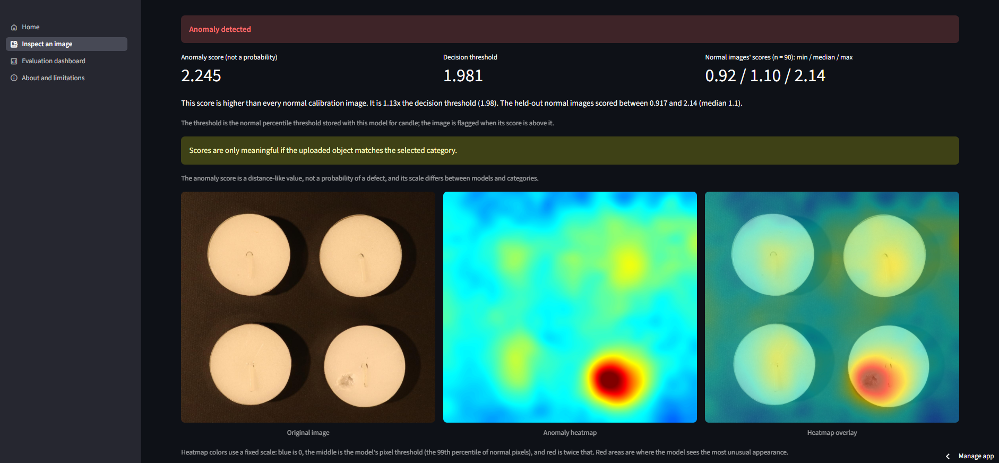

# InspectAI — Industrial Visual Anomaly Detection

**Live demo: [inspectai on Streamlit Community Cloud](https://inspectai-jg5pjtxlnfvxcxxeuhk7r9.streamlit.app/inspect)** (no dataset needed; a free Community Cloud app may take a moment to wake up if it has been idle).

InspectAI finds defective products in photographs, shows where the defect is, and reports how far an image is from normal. It learns **only from normal images** of each product and is evaluated on the VisA benchmark (Amazon, ECCV 2022). Three methods are implemented and compared on identical splits: a classical OpenCV baseline (Model A), a Gaussian feature model on frozen pretrained CNN features (Model B, PaDiM-inspired), and a PatchCore-inspired nearest-neighbor model (Model C). Everything runs on an ordinary Windows CPU, and a Streamlit app serves the saved models. The full specification is in [SPEC.md](SPEC.md).



*Model C (PatchCore-inspired) on a candle image: the score is above the decision threshold, and the heatmap points at the damaged candle in the lower right. Image: VisA (Zou et al., ECCV 2022), CC BY 4.0; resized, heatmap overlay added.*

**Status:** complete and deployed on Streamlit Community Cloud. Model C (dev) is the default; Model A is also selectable. Tested manually on the live app: bundled sample images (normal and defective, candle and pcb1) and an uploaded image all received the correct decision with the matching ground truth, and the link opens publicly in a private browser window with no sign-in. Not yet tested: other browsers and screen sizes, and the host's memory use under load. This is a research and educational prototype, not a certified quality-control system; see [Limitations](#limitations).

## Key features

- **Honest evaluation:** image AUROC and AP with bootstrap confidence intervals and sample counts, pixel metrics, per-category thresholds chosen without test data, paired AUROC differences, and a comparison tool that refuses to compare runs that were not evaluated identically.
- **Optional faster Model C fitting:** `--index-backend tiled` selects the same coreset 2.4x to 4.6x faster per whole fit (see [Model C: speed](#model-c-speed)); the default stays `exact`.
- **Streamlit app:** try a bundled sample image, upload your own, or pick a local test image, see the decision, the score next to its threshold and the normal-score range, the heatmap and overlay, and an evaluation dashboard that validates its data before showing it.
- **Error analysis:** an interactive false-positive / false-negative view in the dashboard to inspect each model's mistakes (images are shown when the VisA dataset is available locally or the image is one of the bundled samples; otherwise only the scores are shown).
- **Checked artifacts:** fitted models are saved as safetensors with checksums, shapes, and a stored split and threshold; they are never pickled and are verified on every load.
- **Three models, one harness:** classical baseline, Gaussian (Mahalanobis) model, and a PatchCore-inspired model with a memory-bank limit, a time limit, and a recorded `max_fit_images` cap.
- **Reproducible and tested:** fixed seeds, bit-for-bit reproducible fits, a synthetic end-to-end demo that needs no dataset or weights, and an automated test suite.
- **Dataset tooling:** a split-file parser and validator for all 12 VisA objects, safe image and mask loading, and reproducible `fit` / `calibration_normal` / `test` splits with no test-set leakage.

## Results at a glance

Unweighted means over seven VisA categories (`cashew`, `pipe_fryum`, `chewinggum`, `fryum`, `candle`, `pcb1`, `pcb2`); seed-42 splits, 256x256 evaluation, thresholds from held-out normal images, one machine. The per-category tables, paired intervals and discussion are in [docs/results.md](docs/results.md).

| Model | Image AUROC | Image AP | Pixel AUROC | Pixel IoU / Dice | F1 at threshold |
|---|---|---|---|---|---|
| A classical | 0.792 | 0.850 | 0.795 | 0.09 / 0.15 | 0.294 |
| B Gaussian `dev` | 0.870 | 0.872 | 0.981 | 0.13 / 0.23 | 0.503 |
| B Gaussian `full` | 0.884 | 0.899 | 0.982 | 0.15 / 0.25 | 0.539 |
| C PatchCore-inspired `dev` | 0.923 | 0.936 | 0.984 | 0.13 / 0.22 | 0.677 |
| C PatchCore-inspired `full` | 0.942 | 0.946 | 0.986 | 0.12 / 0.21 | 0.706 |

What this does and does not show:

- Model C ranks images best on average, but not in every category: against Model B at the same profile, the paired 95% interval of the AUROC difference excludes 0 in 10 of 14 comparisons, and Model C is never significantly worse than the baseline. On `pcb2` the classical baseline has the highest image AUROC of the five configurations.
- Pixel-level overlap is low for every model (IoU 0.00 to 0.30). Pixel AUROC is inflated by the many background pixels.
- F1 depends on a threshold taken from only 45-90 normal images, so compare models by AUROC and the paired intervals, not by F1.
- `candle`, `pcb1` and `pcb2` were fitted on a seeded subset of 400 of about 810 fit images; with seven categories, one seed and 100-150 test images each, differences of a few AUROC points should not be over-read.

## Architecture

```text
 VisA images + masks + split file (outside the repository)
          |
          v
 data/        parse and validate -> fit | calibration_normal | test  (seeded, disjoint, split.json)
          |
          v
 preprocessing/   resize (letterbox or stretch) -> ImageNet normalization
          |
          +--> models/classical   (Model A)  per-pixel mean / std z-score
          |
          +--> models/features    frozen ResNet-18 / Wide ResNet-50-2, layer2 + layer3
                   |
                   +--> models/gaussian   (Model B)  per-position Gaussian, Mahalanobis distance
                   +--> models/patchcore  (Model C)  coreset memory bank, nearest-neighbor distance
          |
          v   anomaly map (input size) + image score (max of the map)
 evaluation/  thresholds from calibration_normal -> score test -> metrics -> predictions.csv, summary.json
          |                                  |
          |                                  v
          |                       artifacts/   manifest + tensors + split + config (checked on load)
          v
 evaluation/comparison  verify + compare -> comparison.json / .csv / .md, figures
          |
          v
 inference/ + ui/   load artifacts -> inspect an image -> Streamlit pages (Home, Inspect, Dashboard, About)
```

How each part works is explained in [docs/architecture.md](docs/architecture.md).

## Technologies

Python 3.12 · PyTorch 2.14 (CPU) and torchvision 0.29 (ImageNet-1k ResNet-18 and Wide ResNet-50-2 weights) · NumPy · OpenCV (headless) · Pillow · scikit-learn (metrics only) · safetensors · PyYAML · psutil · Streamlit 1.66 · pytest · Ruff. The exact versions are pinned in `requirements-lock.txt`. No GPU, paid service, or network call is needed at run time; the only downloads are the explicit weight fetch and the dataset you choose to download.

## Hardware and runtime

| Item | Value |
|---|---|
| Machine used for every measurement | AMD Ryzen 5 5500U (6 cores / 12 threads), 16 GB RAM, no GPU, Windows 11, plugged in, **Balanced** power plan |
| Python / PyTorch | 3.12.2 / 2.14.1+cpu |
| Fit time (400-408 images) | classical about 8 s · Model B 15-66 s · Model C about 10-12 minutes (`exact`, the default) · 133-272 s, about 2.2-4.5 minutes (`--index-backend tiled`, `dev`, measured on seven categories) |
| Prediction latency per image | classical about 14 ms · Model B 34-130 ms · Model C 0.2-0.65 s (`exact`; `dev` about 0.2 s, `full` up to 0.65 s) · 136-169 ms mean (`tiled`, `dev`) |
| Peak memory while fitting | 0.4 GB (classical) · 0.74-1.04 GB (Model B) · 1.2 GB (Model C `dev`) · 2.9 GB (Model C `full`) |
| Synthetic end-to-end demo | about 13 s |
| Tests | 733 passed, 9 deselected (`slow` and `needs_dataset`) |

Model C `full` was not benchmarked with the `tiled` backend. The measurements are detailed in [docs/models.md](docs/models.md), [docs/benchmarks.md](docs/benchmarks.md) and [docs/environment.md](docs/environment.md).

### Model C: speed

`exact` is the default backend and the reference. `tiled` (`--index-backend tiled`) is an optional optimized backend that selects the same coreset with a triangle-inequality prune and searches with a tiled nearest-neighbor kernel that is exact to float32 rounding. Measured on seven categories (`dev` profile, idle machine): the whole fit took 133-272 s instead of about 609-649 s (2.4x to 4.6x faster; the coreset step alone 2.5x to 5.1x), the stored memory banks were byte-identical to the `exact` ones, the image AUROC was unchanged, and the mean prediction latency fell from 196-208 ms to 136-169 ms. The gain depends on the category. See [docs/benchmarks.md](docs/benchmarks.md).

```powershell
python scripts/fit_model.py --model patchcore --category cashew --profile dev --index-backend tiled
```

Two other experiments were negative: a guided filter and an extra `layer1` feature scale did not improve pixel IoU / Dice, and static INT8 gave Model C no speedup and -0.048 AUROC. Both refinements stay off by default (details in [docs/benchmarks.md](docs/benchmarks.md)).

## Documentation

- [docs/architecture.md](docs/architecture.md): data flow, feature extraction, splits and thresholds, how each model scores, persistence, and the UI integration.
- [docs/models.md](docs/models.md): dataset validation, how to fit and evaluate each model, artifacts, and the per-model measured results.
- [docs/results.md](docs/results.md): the comparison report, results by category, paired differences, and what the comparison shows.
- [docs/evaluation.md](docs/evaluation.md): metrics, threshold selection, comparison method, deviations from the published algorithms, and how to reproduce every number.
- [docs/benchmarks.md](docs/benchmarks.md): coreset speedup, localization variants, latency percentiles, and INT8.
- [docs/app.md](docs/app.md): the Streamlit pages and what the app guarantees.
- [docs/deployment.md](docs/deployment.md): the hosted bundle and what is and is not verified about the deployment.
- [docs/dataset_setup.md](docs/dataset_setup.md): downloading, verifying and placing the VisA dataset and the pretrained weights.
- [docs/limitations.md](docs/limitations.md): what the results do not show, what is unfinished, and future work.
- [docs/final_report.md](docs/final_report.md): the final project report with the Definition-of-Done check and the milestone checklist.
- [docs/environment.md](docs/environment.md): hardware, versions, and locations.
- [docs/troubleshooting.md](docs/troubleshooting.md): common errors, exit codes and their fixes.

## Installation (Windows PowerShell)

Keep the repository, virtual environment, dataset, and artifacts **outside OneDrive** (SPEC.md Section 9.2); a OneDrive-synced folder can lock or re-upload large files. If you must use a synced folder, pause syncing for these directories.

```powershell
# 1. Virtual environment (outside OneDrive)
New-Item -ItemType Directory -Force C:\dev\venvs | Out-Null
py -3.12 -m venv C:\dev\venvs\inspectai
C:\dev\venvs\inspectai\Scripts\Activate.ps1
python -m pip install --upgrade pip

# 2. CPU-only PyTorch first, then the project
pip install torch torchvision --index-url https://download.pytorch.org/whl/cpu
cd C:\dev\inspectai
pip install -e ".[dev]"
```

`requirements-lock.txt` lists the exact package versions the project was last verified with. Problems? See [docs/troubleshooting.md](docs/troubleshooting.md).

### Environment variables

Machine-specific locations come from environment variables and are never committed (`configs/default.yaml` refers to them as `${INSPECTAI_DATA_ROOT}` and so on). Set them once for your user account, then open a new terminal:

```powershell
[Environment]::SetEnvironmentVariable('INSPECTAI_DATA_ROOT',    'C:\dev\inspectai-data',           'User')
[Environment]::SetEnvironmentVariable('INSPECTAI_ARTIFACT_DIR', 'C:\dev\inspectai-data\artifacts', 'User')
[Environment]::SetEnvironmentVariable('INSPECTAI_REPORT_DIR',   'C:\dev\inspectai-data\reports',   'User')
[Environment]::SetEnvironmentVariable('TORCH_HOME',             'C:\dev\inspectai-data\torch_cache', 'User')
```

### Configuration

`configs/default.yaml` is the readable reference of every default (splits, thresholds, evaluation, model settings, limits, upload rules). `inspectai.settings.load_default_config` validates it by building the real settings objects (an invalid value raises a clear `ConfigError`), and a test fails if any value in the file differs from the default in the code. Command-line flags override the defaults. Only CPU execution is supported: `device: cpu` is the only accepted value, and nothing is ever moved to a GPU.

## Quick start

The VisA dataset is **not** part of this repository and no script downloads it; download it yourself from the official source (<https://github.com/amazon-science/spot-diff>, CC BY 4.0) as described in [docs/dataset_setup.md](docs/dataset_setup.md). Then, for one category:

```powershell
python scripts/validate_dataset.py --objects cashew --write-splits        # check the data, write the split
python scripts/fetch_weights.py --backbone resnet18                       # explicit weight download, 45 MB
python scripts/fit_model.py --model patchcore --category cashew --profile dev
python scripts/evaluate_model.py --model patchcore --category cashew --profile dev
streamlit run app.py                                                      # http://localhost:8501
```

Without cached weights the scripts and the app stop with an explanation (exit code 4) and never use random weights. Fitting Model C takes about 11 minutes per category with the default backend (see the speed section above). The other models and options are in [docs/models.md](docs/models.md).

## Verify the setup

```powershell
python -c "import inspectai; print(inspectai.__version__)"
pytest                                    # needs neither the dataset nor weights
ruff check . ; ruff format --check .
python scripts/run_demo.py                # about 13 seconds, synthetic data, end to end
pytest -m "needs_dataset or slow"         # optional: uses the real dataset and cached weights
```

`scripts/run_demo.py` generates a small synthetic VisA-style dataset, fits all three models with a deterministic fake backbone, reloads the saved artifacts, predicts every test image the way the app does, checks each score and decision against the saved evaluation report, and writes a comparison report, a visualization, and prediction details. Its metrics come from random synthetic images and mean nothing; it proves that the pipeline works end to end.

## Streamlit app

```powershell
streamlit run app.py
```

The app opens at `http://localhost:8501` and listens on this computer only (`.streamlit/config.toml` sets `address = "localhost"`; change it explicitly if you host the app). Pages:

- **Home**: purpose, which fitted models and categories exist, how to upload an image, and the limitations.
- **Inspect an image**: choose a model and a category, upload a JPG, JPEG, or PNG image (up to 10 MB) or, if the local VisA dataset is available, pick one of its test images. It shows the original image, the heatmap, the overlay, the decision, the score next to the category's stored threshold and the range of the normal scores, always with the warning that scores are only meaningful if the object matches the category. On the hosted app, **Try a sample image** is the default: it offers bundled VisA test images of the selected category (2 normal and 2 anomalous, plus a featured example) and starts on the featured candle example, so one click shows a result. After a run it shows the ground-truth label next to the decision and, for anomalous samples, the ground-truth defect outline next to the heatmap.
- **Evaluation dashboard**: the saved evaluation metrics with the split named, a model comparison with paired differences, confusion matrices, fit time, latency and memory, and an **Error analysis** section for the false positives and false negatives of a model.
- **About and limitations**.

Uploads are validated before any model runs, the decision is always the one stored with the artifact, a missing or corrupt model shows `Model unavailable` and never a made-up result, and errors never expose file paths or stack traces. The full list of guarantees and how it was tested is in [docs/app.md](docs/app.md).

## Deployment

The app is deployed on Streamlit Community Cloud from the bundle in `hosted/` (about 413 MB, of which the sample images are 5.5 MB), which makes it run without the dataset or a weights cache: **Model C (PatchCore-inspired, `dev`) is the default inspection model**, Model A stays selectable, and Model B and Model C `full` are not included. When `INSPECTAI_DATA_ROOT` is not set, the app uses `hosted/artifacts` and `hosted/reports` automatically. `requirements.txt` installs the project with the CPU PyTorch wheels, and the project supports **Python 3.12 only** (select it in the app's Advanced settings on Community Cloud).

What has and has not been verified:

- **Verified locally:** every bundled artifact passes the artifact store's integrity checks, and scores computed from the bundle alone matched the stored evaluation scores exactly for 28 test images across all seven categories. The 29 bundled sample images are test-split images, and their scores from the bundled Model C `dev` and Model A artifacts equal the saved evaluation scores (relative tolerance 1e-5).
- **Tested manually on the live app:** bundled sample images (normal and defective, candle and pcb1) and an uploaded image all received the correct decision with the matching ground truth, and the link opens publicly in a private browser window with no sign-in.
- **Not verified:** behavior in other browsers or on other screen sizes, and memory use on the host and reliability under load.

Details and the bundle contents are in [docs/deployment.md](docs/deployment.md).

## Limitations

The full list is in [docs/limitations.md](docs/limitations.md). The most important points:

- Seven of the twelve VisA objects were evaluated, with 50-100 normal and 100 anomalous test images each; one seed and one machine. Read the confidence intervals. `candle`, `pcb1`, and `pcb2` were fitted on 400 of about 810 fit images (`--max-fit-images`).
- Model C is better than Model B in most but not all categories, and the `full` profile is not always better than `dev`; the ranking depends on the category. The classical baseline is competitive on `pcb2` (image AUROC 0.919, the highest of the five configurations there) and beats Model B on it, although it localizes defects poorly.
- Thresholds come from 45-90 held-out normal images, so they are conservative: few false alarms, but moderate recall (0.06 to 0.90 by model and category). Compare models by AUROC and paired intervals, not by F1.
- Defect localization is coarse (pixel IoU 0.00 to 0.30), and small or faint defects are often missed. The guided-filter and `layer1` refinements did not improve it.
- An anomaly score is not a probability, and scores are only meaningful if the object matches the selected category.
- Not done: cross-browser and screen-size testing of the app, measurement of the hosted app's memory use and reliability under load, a tiled-backend benchmark for Model C `full`, the other five VisA objects, fits of the added categories on all of their fit images, a hosted float16 profile, and benchmarking on the High-performance power plan.

## License

The InspectAI source code and documentation are released under the [MIT License](LICENSE). The license does not cover the VisA dataset, which is not part of this repository and keeps its own license (below).

## Dataset attribution and licensing

VisA is released under CC BY 4.0. Cite: Zou, Jeong, Pemula, Zhang, and Dabeer, "SPot-the-Difference Self-Supervised Pre-training for Anomaly Detection and Segmentation", ECCV 2022 (arXiv:2207.14315). See SPEC.md Section 3.1 for the attribution rules that apply to figures derived from the dataset.

The example figures in [docs/results.md](docs/results.md) and [docs/final_report.md](docs/final_report.md) and the image at the top use VisA images and are modified material (resized, with heatmaps and text added).
