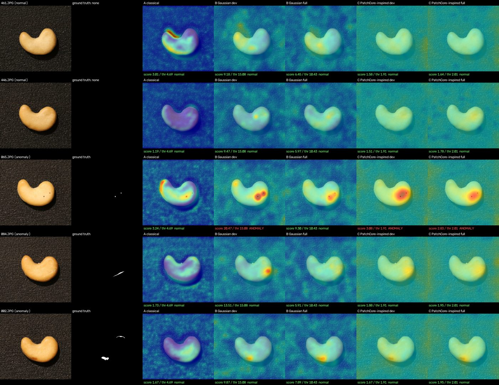
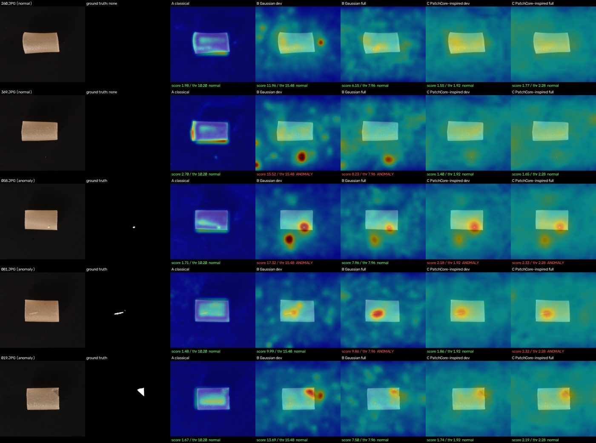

# Comparison report and results by category

Moved from the README so that it stays short. All numbers are unchanged. The per-model sections are in [models.md](models.md).

## Comparison report

```powershell
python scripts/compare_models.py                      # all seven categories
python scripts/compare_models.py --categories cashew pipe_fryum --no-figures
```

`scripts/compare_models.py` reads the results that `evaluate_model.py` wrote for every model and writes `<INSPECTAI_REPORT_DIR>\comparison\`: `comparison.json` (every run's configuration, thresholds, weights and checksums, library versions, power state, and all metrics), `comparison.csv` (one flat row per category and model), `comparison.md` (tables, paired differences, macro averages, protocol, how to reproduce), and `<category>_examples.png`. Undefined metrics are written as `undefined`, never as a number.

What the tool enforces rather than assumes:

- **Identical splits and settings.** A category is refused (exit code 2) unless every model used the same fit / calibration / test file-list hashes, split seed, evaluated split, evaluation resolution, threshold policy and quantile, bootstrap settings, sample counts, and the same test images with the same labels.
- **Metrics come from the actual predictions.** Every image-level metric (AUROC and its bootstrap interval, AP, confusion matrix, precision, recall, F1, FPR, FNR) is re-derived from the run's saved `predictions.csv` (per-image score and split-file label) and must match the harness summary. Pixel metrics need the full anomaly maps, so they are copied from the summaries and labeled as such.
- **The artifact matches the report.** When making the figures, each saved artifact must reproduce the scores in its own `predictions.csv` for the displayed images, or the comparison stops.
- **Measured versus not measured.** A model with no results for a category is listed as "not measured" and left out of the tables and macro average; it is never filled in. Categories with fewer than two measured models are listed as not compared.
- **Paired differences.** Because all models score the same test images, the report also gives paired bootstrap 95% intervals for AUROC differences (same resampled images for both models), which are tighter and more appropriate than comparing two separate intervals.

The example figures show, for every model, two normal images and a small / median / large defect. Images are chosen without looking at any model output: two normal images at random (seed 42), and the anomalous images at the 15th / 50th / 85th percentile of ground-truth mask area. Each model's colors are anchored at its own pixel threshold: blue is 0, the middle of the scale is the threshold (the 99th percentile of normal calibration pixels), and red is twice the threshold.

### Results by category

Seven categories are measured with all five configurations: the four initial categories of SPEC.md Section 3.2 (`cashew`, `pipe_fryum`, `chewinggum`, `fryum`) and, added afterwards, `candle`, `pcb1`, and `pcb2`. Settings: seed-42 splits, 256x256 evaluation resolution, `normal_percentile` thresholds (q = 0.99, 45 calibration images in the first four categories and 90 in the new three), 1000 bootstrap resamples, one machine (Windows Balanced power plan, plugged in). The tables are copied from `comparison.md`.

| Group | Categories | Fit images | Test images (normal / anomalous) |
|---|---|---|---|
| Initial four | `cashew`, `pipe_fryum`, `chewinggum`, `fryum` | all 405-408 | 50 / 100 |
| Added | `candle`, `pcb1`, `pcb2` | **400 of 810-814** (seeded random subset) | 100 / 100 |

`candle`, `pcb1`, and `pcb2` have about 900 normal training images, about twice as many as the initial four. At the `full` profile the memory-bank estimate for all of them (900 x 784 x 1536 x 4 bytes, about 4.3 GB) would exceed the default `max_bank_gb` of 4, and coreset selection on twice the patches would take roughly five times longer than the 11 minutes measured, past `max_fit_minutes`. SPEC.md Section 3.2 anticipates this and offers `--max-fit-images`, so **every one of the five configurations** of these three categories was fitted on the same seeded random subset of 400 fit images (the subset is recorded in `split.json` and in each summary, and the comparison tool refuses runs that used different subsets). The 400-image size was chosen to match the first four categories' ~405 and was not tuned. Models therefore did not see the other ~410 normal images of these categories, and the results are not comparable one-to-one with a fit on all images. Reproduce them by adding `--max-fit-images 400` to every `fit_model.py` command and to the classical `evaluate_model.py` command (`evaluate_model.py` rejects the option for the other models, which take the subset from their artifact):

```powershell
python scripts/evaluate_model.py --model classical --category candle --max-fit-images 400
python scripts/fit_model.py --model classical --category candle --max-fit-images 400
python scripts/fit_model.py --model patchcore --category candle --profile dev --max-fit-images 400
```

#### cashew

| Model | Image AUROC (95% CI) | Image AP | Pixel AUROC | Pixel IoU / Dice | Precision | Recall | FPR | F1 | Fit time | Latency |
|---|---|---|---|---|---|---|---|---|---|---|
| A classical | 0.701 (0.603-0.794) | 0.818 | 0.809 | 0.21 / 0.35 | 1.000 | 0.180 | 0.000 | 0.305 | 7.8 s | 14 ms |
| B Gaussian dev | 0.916 (0.871-0.955) | 0.962 | 0.987 | 0.19 / 0.32 | 1.000 | 0.540 | 0.000 | 0.701 | 17.4 s | 39 ms |
| B Gaussian full | 0.876 (0.818-0.928) | 0.937 | 0.990 | 0.26 / 0.41 | 1.000 | 0.140 | 0.000 | 0.246 | 50.9 s | 122 ms |
| C PatchCore-inspired dev | 0.955 (0.922-0.981) | 0.978 | 0.990 | 0.20 / 0.34 | 1.000 | 0.580 | 0.000 | 0.734 | 649.4 s | 205 ms |
| C PatchCore-inspired full | 0.968 (0.944-0.987) | 0.984 | 0.992 | 0.19 / 0.33 | 1.000 | 0.640 | 0.000 | 0.780 | 681.8 s | 592 ms |

#### pipe_fryum

| Model | Image AUROC (95% CI) | Image AP | Pixel AUROC | Pixel IoU / Dice | Precision | Recall | FPR | F1 | Fit time | Latency |
|---|---|---|---|---|---|---|---|---|---|---|
| A classical | 0.674 (0.587-0.759) | 0.818 | 0.963 | 0.24 / 0.39 | 1.000 | 0.080 | 0.000 | 0.148 | 7.2 s | 14 ms |
| B Gaussian dev | 0.933 (0.885-0.967) | 0.963 | 0.992 | 0.20 / 0.34 | 0.965 | 0.550 | 0.040 | 0.701 | 16.2 s | 37 ms |
| B Gaussian full | 0.932 (0.882-0.973) | 0.960 | 0.994 | 0.24 / 0.39 | 0.934 | 0.570 | 0.080 | 0.708 | 52.4 s | 130 ms |
| C PatchCore-inspired dev | 0.982 (0.964-0.995) | 0.992 | 0.992 | 0.18 / 0.31 | 1.000 | 0.600 | 0.000 | 0.750 | 635.0 s | 196 ms |
| C PatchCore-inspired full | 0.990 (0.977-0.998) | 0.995 | 0.994 | 0.19 / 0.33 | 1.000 | 0.520 | 0.000 | 0.684 | 686.9 s | 650 ms |

#### chewinggum

| Model | Image AUROC (95% CI) | Image AP | Pixel AUROC | Pixel IoU / Dice | Precision | Recall | FPR | F1 | Fit time | Latency |
|---|---|---|---|---|---|---|---|---|---|---|
| A classical | 0.790 (0.706-0.865) | 0.873 | 0.810 | 0.07 / 0.13 | 1.000 | 0.060 | 0.000 | 0.113 | 7.6 s | 14 ms |
| B Gaussian dev | 0.974 (0.947-0.994) | 0.989 | 0.985 | 0.10 / 0.18 | 1.000 | 0.780 | 0.000 | 0.876 | 17.1 s | 34 ms |
| B Gaussian full | 0.973 (0.948-0.992) | 0.988 | 0.983 | 0.11 / 0.20 | 1.000 | 0.690 | 0.000 | 0.817 | 44.9 s | 106 ms |
| C PatchCore-inspired dev | 0.968 (0.940-0.991) | 0.987 | 0.984 | 0.08 / 0.14 | 0.989 | 0.890 | 0.020 | 0.937 | 638.7 s | 199 ms |
| C PatchCore-inspired full | 0.967 (0.938-0.991) | 0.987 | 0.982 | 0.08 / 0.14 | 0.989 | 0.900 | 0.020 | 0.942 | 716.0 s | 578 ms |

#### fryum

| Model | Image AUROC (95% CI) | Image AP | Pixel AUROC | Pixel IoU / Dice | Precision | Recall | FPR | F1 | Fit time | Latency |
|---|---|---|---|---|---|---|---|---|---|---|
| A classical | 0.785 (0.700-0.856) | 0.868 | 0.621 | 0.05 / 0.10 | 0.875 | 0.210 | 0.060 | 0.339 | 7.4 s | 13 ms |
| B Gaussian dev | 0.848 (0.778-0.908) | 0.911 | 0.967 | 0.27 / 0.43 | 1.000 | 0.170 | 0.000 | 0.291 | 15.2 s | 35 ms |
| B Gaussian full | 0.866 (0.803-0.922) | 0.921 | 0.965 | 0.26 / 0.42 | 0.950 | 0.380 | 0.040 | 0.543 | 46.1 s | 110 ms |
| C PatchCore-inspired dev | 0.864 (0.799-0.915) | 0.939 | 0.970 | 0.30 / 0.46 | 1.000 | 0.540 | 0.000 | 0.701 | 644.1 s | 208 ms |
| C PatchCore-inspired full | 0.914 (0.864-0.952) | 0.959 | 0.967 | 0.25 / 0.40 | 1.000 | 0.480 | 0.000 | 0.649 | 680.2 s | 577 ms |

#### candle

Fitted on 400 of 810 fit images; 100 normal and 100 anomalous test images.

| Model | Image AUROC (95% CI) | Image AP | Pixel AUROC | Pixel IoU / Dice | Precision | Recall | FPR | F1 | Fit time | Latency |
|---|---|---|---|---|---|---|---|---|---|---|
| A classical | 0.838 (0.784-0.889) | 0.856 | 0.832 | 0.02 / 0.04 | 0.930 | 0.400 | 0.030 | 0.559 | 8.2 s | 13 ms |
| B Gaussian dev | 0.816 (0.754-0.871) | 0.755 | 0.977 | 0.02 / 0.05 | 0.700 | 0.070 | 0.030 | 0.127 | 18.7 s | 46 ms |
| B Gaussian full | 0.869 (0.819-0.914) | 0.857 | 0.987 | 0.03 / 0.06 | 0.920 | 0.230 | 0.020 | 0.368 | 65.9 s | 110 ms |
| C PatchCore-inspired dev | 0.913 (0.873-0.947) | 0.900 | 0.984 | 0.02 / 0.05 | 0.935 | 0.290 | 0.020 | 0.443 | 608.8 s | 198 ms |
| C PatchCore-inspired full | 0.935 (0.897-0.967) | 0.910 | 0.989 | 0.03 / 0.06 | 0.957 | 0.450 | 0.020 | 0.612 | 662.0 s | 580 ms |

#### pcb1

Fitted on 400 of 814 fit images; 100 normal and 100 anomalous test images.

| Model | Image AUROC (95% CI) | Image AP | Pixel AUROC | Pixel IoU / Dice | Precision | Recall | FPR | F1 | Fit time | Latency |
|---|---|---|---|---|---|---|---|---|---|---|
| A classical | 0.834 (0.778-0.885) | 0.813 | 0.833 | 0.03 / 0.06 | 0.917 | 0.110 | 0.010 | 0.196 | 7.7 s | 13 ms |
| B Gaussian dev | 0.856 (0.797-0.907) | 0.794 | 0.990 | 0.09 / 0.16 | 0.833 | 0.450 | 0.090 | 0.584 | 15.5 s | 35 ms |
| B Gaussian full | 0.856 (0.805-0.907) | 0.807 | 0.990 | 0.09 / 0.16 | 0.870 | 0.400 | 0.060 | 0.548 | 45.5 s | 114 ms |
| C PatchCore-inspired dev | 0.883 (0.828-0.927) | 0.874 | 0.992 | 0.10 / 0.17 | 0.918 | 0.450 | 0.040 | 0.604 | 609.7 s | 198 ms |
| C PatchCore-inspired full | 0.902 (0.857-0.945) | 0.884 | 0.995 | 0.09 / 0.16 | 0.909 | 0.400 | 0.040 | 0.556 | 660.9 s | 582 ms |

#### pcb2

Fitted on 400 of 811 fit images; 100 normal and 100 anomalous test images.

| Model | Image AUROC (95% CI) | Image AP | Pixel AUROC | Pixel IoU / Dice | Precision | Recall | FPR | F1 | Fit time | Latency |
|---|---|---|---|---|---|---|---|---|---|---|
| A classical | 0.919 (0.875-0.955) | 0.905 | 0.696 | 0.00 / 0.01 | 0.926 | 0.250 | 0.020 | 0.394 | 7.7 s | 13 ms |
| B Gaussian dev | 0.745 (0.675-0.809) | 0.728 | 0.969 | 0.05 / 0.10 | 0.824 | 0.140 | 0.030 | 0.239 | 15.0 s | 35 ms |
| B Gaussian full | 0.819 (0.760-0.872) | 0.825 | 0.968 | 0.05 / 0.10 | 0.950 | 0.380 | 0.020 | 0.543 | 45.0 s | 116 ms |
| C PatchCore-inspired dev | 0.897 (0.849-0.940) | 0.882 | 0.977 | 0.03 / 0.07 | 0.932 | 0.410 | 0.030 | 0.569 | 609.4 s | 198 ms |
| C PatchCore-inspired full | 0.914 (0.870-0.950) | 0.900 | 0.980 | 0.04 / 0.07 | 0.922 | 0.590 | 0.050 | 0.720 | 663.3 s | 580 ms |

#### Macro average over all seven categories

Unweighted means over the seven categories, for every model (undefined values would be skipped; there are none). The first four and the added three were fitted on different numbers of images (see above), so the second table below keeps the original four-category means unchanged.

| Model | Categories | Image AUROC | Image AP | Pixel AUROC | Pixel IoU | Pixel Dice | F1 |
|---|---|---|---|---|---|---|---|
| A classical | 7 | 0.792 | 0.850 | 0.795 | 0.09 | 0.15 | 0.294 |
| B Gaussian dev | 7 | 0.870 | 0.872 | 0.981 | 0.13 | 0.23 | 0.503 |
| B Gaussian full | 7 | 0.884 | 0.899 | 0.982 | 0.15 | 0.25 | 0.539 |
| C PatchCore-inspired dev | 7 | 0.923 | 0.936 | 0.984 | 0.13 | 0.22 | 0.677 |
| C PatchCore-inspired full | 7 | 0.942 | 0.946 | 0.986 | 0.12 | 0.21 | 0.706 |

#### Macro average over the first four categories

Unweighted means over `cashew`, `pipe_fryum`, `chewinggum`, and `fryum` (from the earlier four-category comparison; the per-category numbers above are unchanged).

| Model | Categories | Image AUROC | Image AP | Pixel AUROC | Pixel IoU | Pixel Dice | F1 |
|---|---|---|---|---|---|---|---|
| A classical | 4 (cashew, pipe_fryum, chewinggum, fryum) | 0.738 | 0.844 | 0.801 | 0.14 | 0.24 | 0.226 |
| B Gaussian dev | 4 (cashew, pipe_fryum, chewinggum, fryum) | 0.918 | 0.956 | 0.983 | 0.19 | 0.32 | 0.642 |
| B Gaussian full | 4 (cashew, pipe_fryum, chewinggum, fryum) | 0.912 | 0.952 | 0.983 | 0.22 | 0.35 | 0.578 |
| C PatchCore-inspired dev | 4 (cashew, pipe_fryum, chewinggum, fryum) | 0.942 | 0.974 | 0.984 | 0.19 | 0.31 | 0.781 |
| C PatchCore-inspired full | 4 (cashew, pipe_fryum, chewinggum, fryum) | 0.960 | 0.981 | 0.984 | 0.18 | 0.30 | 0.764 |

#### Model C against Model B (same profile, same test images)

| Category | Profile | AUROC(C) - AUROC(B), paired 95% interval | Excludes 0 |
|---|---|---|---|
| cashew | dev | +0.038 (+0.001 to +0.079) | yes |
| cashew | full | +0.092 (+0.046 to +0.147) | yes |
| pipe_fryum | dev | +0.050 (+0.015 to +0.096) | yes |
| pipe_fryum | full | +0.058 (+0.017 to +0.105) | yes |
| chewinggum | dev | -0.006 (-0.027 to +0.012) | no |
| chewinggum | full | -0.006 (-0.033 to +0.020) | no |
| fryum | dev | +0.017 (-0.051 to +0.082) | no |
| fryum | full | +0.048 (+0.001 to +0.100) | yes |
| candle | dev | +0.097 (+0.048 to +0.145) | yes |
| candle | full | +0.066 (+0.032 to +0.102) | yes |
| pcb1 | dev | +0.027 (-0.021 to +0.075) | no |
| pcb1 | full | +0.046 (+0.016 to +0.079) | yes |
| pcb2 | dev | +0.152 (+0.100 to +0.208) | yes |
| pcb2 | full | +0.095 (+0.054 to +0.140) | yes |

#### Deep models against the classical baseline, added categories (paired, same test images)

| Category | Model | AUROC difference to A classical, paired 95% interval | Excludes 0 |
|---|---|---|---|
| candle | B dev | -0.021 (-0.098 to +0.053) | no |
| candle | B full | +0.032 (-0.032 to +0.098) | no |
| candle | C dev | +0.076 (+0.017 to +0.137) | yes |
| candle | C full | +0.098 (+0.039 to +0.158) | yes |
| pcb1 | B dev | +0.022 (-0.033 to +0.081) | no |
| pcb1 | B full | +0.022 (-0.031 to +0.072) | no |
| pcb1 | C dev | +0.049 (-0.013 to +0.112) | no |
| pcb1 | C full | +0.068 (+0.011 to +0.128) | yes |
| pcb2 | B dev | -0.174 (-0.246 to -0.110) | yes (baseline better) |
| pcb2 | B full | -0.100 (-0.163 to -0.045) | yes (baseline better) |
| pcb2 | C dev | -0.023 (-0.080 to +0.028) | no |
| pcb2 | C full | -0.005 (-0.058 to +0.046) | no |

### What the comparison shows

- **In the first four categories both deep models rank images better than the classical baseline, by very different margins; in the added three that no longer holds everywhere.** First four: all 16 paired AUROC differences against the baseline are positive (+0.062 to +0.316) and 15 of 16 intervals exclude 0. The exception is Model B `dev` on `fryum` (+0.062, paired 95% interval -0.010 to +0.134). `fryum` is the hardest of those four for the deep models: the mean image AUROC of the four deep configurations is 0.873 there (0.848-0.914 individually), against 0.929-0.971 in the other three, and the classical baseline reaches 0.785 there. Added three (12 comparisons): 7 differences are positive, but only 3 intervals exclude 0 in the deep model's favour (Model C on `candle` in both profiles, Model C `full` on `pcb1`); 2 exclude 0 in the **baseline's** favour (Model B on `pcb2`: -0.174 `dev`, -0.100 `full`); the other 7 show no demonstrated difference. Over all seven categories (28 comparisons): 23 positive, 18 exclude 0 in the deep model's favour, 2 exclude 0 against it. Model C is never significantly worse than the baseline (11 of its 14 comparisons favour it with an interval excluding 0, the other 3 are `pcb1` `dev` and `pcb2` `dev`/`full`). On `pcb2` the classical baseline has the highest image AUROC of the five configurations (0.919, against 0.914 for Model C `full`; the paired difference is not significant). A plausible but untested explanation is that the PCBs are imaged in a very consistent position, which is the one condition the position-wise baseline needs; the baseline's pixel-level result is nevertheless the worst of any configuration (pixel AUROC 0.696, IoU 0.00), so it ranks images well there but does not localize defects.
- **Model C is better than Model B more often than not, but not everywhere.** Over all seven categories Model C has the higher AUROC in 12 of 14 same-profile comparisons and the paired interval excludes 0 in 10 (cashew `dev` and `full`, pipe_fryum `dev` and `full`, fryum `full` (lower bound only +0.001), candle `dev` and `full`, pcb1 `full`, pcb2 `dev` and `full`). The paired interval includes 0 for `chewinggum` `dev` (-0.006, paired 95% interval -0.027 to +0.012); `chewinggum` `full` (-0.006, paired 95% interval -0.033 to +0.020); `fryum` `dev` (+0.017, paired 95% interval -0.051 to +0.082); and `pcb1` `dev` (+0.027, paired 95% interval -0.021 to +0.075), so no difference is demonstrated there. The two negative point estimates are both `chewinggum`. The added three categories all favour Model C (largest on `pcb2`, +0.152 `dev`), so the ranking depends on the category, but less than it seemed from the first four.
- **Model C `full` against `dev`.** `full` is better on `fryum` (0.864 to 0.914), `candle` (0.913 to 0.935), `pcb1` (0.883 to 0.902), `pcb2` (0.897 to 0.914), and slightly better on `cashew` and `pipe_fryum`, but not on `chewinggum` (0.968 to 0.967). No paired test between profiles is part of the report, so these are point estimates. Model B `full` is better than `dev` on `candle` (0.816 to 0.869) and `pcb2` (0.745 to 0.819), the same on `pcb1` (0.856 for both) and `pipe_fryum`, and worse on `cashew` (0.916 to 0.876). Macro image AUROC over all four initial categories: classical 0.738, Model B 0.918 (`dev`) / 0.912 (`full`), Model C 0.942 (`dev`) / 0.960 (`full`); over all seven: classical 0.792, Model B 0.870 / 0.884, Model C 0.923 / 0.942.
- **F1 at the calibrated threshold does not follow ranking quality.** Each threshold comes from only 45 calibration images (the 0.99 quantile sits near their maximum), so recall differs a lot between models. For example, on `fryum` the classical baseline's F1 (0.339) is higher than Model B `dev`'s (0.291) even though Model B ranks images better, because Model B `dev`'s threshold flags only 17% of the defective images. Compare models by AUROC and the paired intervals, not by F1.
- **Pixel-level overlap is low for every model** (IoU 0.00-0.30; only 0.02-0.10 in `candle`, `pcb1`, and `pcb2`, where the defects are small): thresholds taken from normal pixels are conservative and the masks are small. Pixel AUROC is 0.965-0.995 for the deep models, but that is mostly the many background pixels; the classical baseline's pixel AUROC drops to 0.621 on `fryum` and 0.696 on `pcb2`.
- **Costs differ by orders of magnitude.** Fit time: 7-8 s (classical), 15-66 s (Model B), 10.1-11.9 minutes (Model C; 400 images in the added categories take as long as 405 because the coreset search depends on the number of fit images). Mean per-image prediction latency: 13-14 ms, 34-130 ms, and 196-650 ms. Peak fit memory in the added categories: 0.40 GB (classical), 0.77-1.01 GB (Model B), 1.23-1.25 GB (Model C `dev`), 2.85 GB (Model C `full`).
- **Limits.** Seven categories, each with 100-150 test images (50-100 normal and 100 anomalous), one seed, one machine: differences of a few AUROC points should not be over-read. The added three categories were fitted on 400 of about 810 fit images (see above), so their numbers describe that setting and could differ with a full fit. Published VisA results are not compared because their protocols differ. The remaining five VisA objects (`capsules`, `macaroni1`, `macaroni2`, `pcb3`, `pcb4`) were not run (SPEC.md Section 3.2).
- **Run history.** An earlier batch for `chewinggum` and `fryum` was stopped by the environment because the machine ran low on memory. The missing runs were then repeated strictly one step at a time with about 7 GB of RAM free; every step exited cleanly, and no partial results were kept. The `candle`, `pcb1`, and `pcb2` runs were also executed strictly one step at a time (about 6 GB of RAM free, after stopping a leftover Streamlit server); all 30 steps (10 per category) finished and produced their artifacts and reports.

## Example outputs

Each row is one test image; the columns are the original image, the ground-truth defect mask (black for normal images), and the anomaly heatmap overlaid on the image for each model, with the score, the model's threshold, and the decision under it. The images were chosen without looking at any model output: two normal images at random and the small, median, and large defect by mask area. They include false alarms and misses; nothing was filtered.





*Dataset images: VisA (Zou et al., ECCV 2022), licensed CC BY 4.0, https://github.com/amazon-science/spot-diff. These figures are modified material: images were resized and heatmap overlays and text were added. Full-size figures for all seven categories are generated by `scripts/compare_models.py`.*

